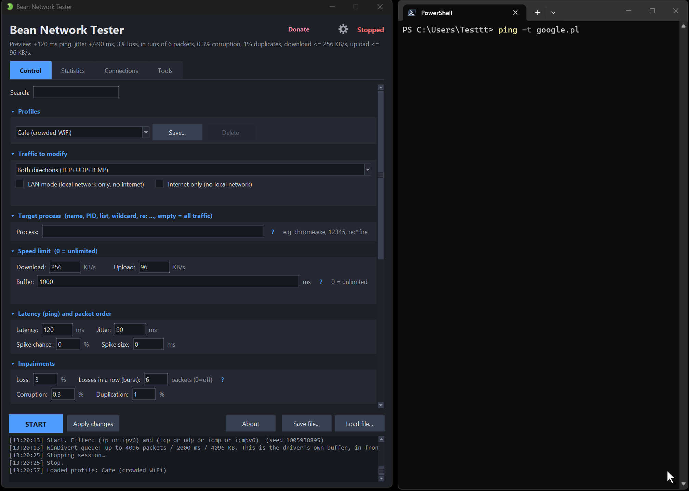

<p align="center">
  <a href="README.md">English</a> | <a href="README.zh-Hans.md">简体中文</a> | <a href="README.ja.md">日本語</a> | <b>Deutsch</b> | <a href="README.ko.md">한국어</a> | <a href="README.fr.md">Français</a> | <a href="README.pt-BR.md">Português (Brasil)</a> | <a href="README.es.md">Español</a>
</p>

# Bean Network Tester 🫘 - Simulator für schlechte Netzwerkbedingungen (Windows)
<p align="center">
  <b>Folgen Sie mir:</b>
  &nbsp
  <a href="https://discord.gg/bDTu8HX"></a>
  &nbsp
  <a href="https://facebook.com/donislawdev"></a>
  &nbsp
  <a href="https://x.com/donislawdev"><picture><source media="(prefers-color-scheme: dark)" srcset="https://cdn.simpleicons.org/x/FFFFFF"></picture></a>
  &nbsp
  <a href="https://bsky.app/profile/donislawdev.bsky.social"></a>
  &nbsp
 <a href="https://store.steampowered.com/developer/DonislawDev"><picture><source media="(prefers-color-scheme: dark)" srcset="https://cdn.simpleicons.org/steam/FFFFFF"></picture></a>
</p>

[](https://github.com/donislawdev/BeanNetworkTester/actions/workflows/ci.yml)
[](https://github.com/donislawdev/BeanNetworkTester/releases/latest)
[](https://github.com/donislawdev/BeanNetworkTester/releases)
[](LICENSE)
[](https://scorecard.dev/viewer/?uri=github.com/donislawdev/BeanNetworkTester)
[](https://www.bestpractices.dev/projects/14154)


**Bean Network Tester** ist ein Werkzeug für Tester und Entwickler: Prüfen Sie, wie sich Ihre
Anwendung bei einer schlechten Verbindung verhält. Wie Clumsy oder NetLimiter lässt es Sie das
Netzwerk gezielt verschlechtern - Ping hinzufügen, Pakete verwerfen, die Geschwindigkeit
begrenzen, Verbindungen kappen und mehr. Es arbeitet, indem es den Datenverkehr mit dem
**[WinDivert](https://www.reqrypt.org/windivert.html)**-Treiber abfängt (über
**[PyDivert](https://github.com/ffalcinelli/pydivert)**), und bietet sowohl eine übersichtliche
Fensteroberfläche mit Tooltips als auch einen Befehlszeilenmodus für CI.

⭐ **Wenn es Ihnen Zeit gespart hat, hinterlassen Sie einen Stern.** So erfährt der nächste Tester,
der es braucht, dass es existiert.

**Was es kann**

- **Verzögerung und Jitter hinzufügen** - feste oder zufällige Verzögerung, dazu gelegentliche
  Spitzen.
- **Pakete verwerfen, beschädigen oder duplizieren** - Verluste können gebündelt auftreten, so wie
  eine echte Funkverbindung ausfällt.
- **Download-/Upload-Geschwindigkeit begrenzen** - auf eine feste Zahl KB/s drosseln, mit einem
  Puffer, der Warteschlangenverzögerung erzeugt, bevor Pakete verworfen werden.
- **Verbindungen kappen** - TCP-Resets, eine tote Verbindung oder neue Verbindungen, die nie
  zustande kommen.
- **Die Verbindung ein- und ausschalten** - Ausfälle, die kommen und gehen.
- **Den Pfad stören, nicht nur die Pakete** - ein MTU-Black-Hole und Leerlauf-Timeouts nach Art von
  NAT.
- **Ports oder IPs sperren** - eine kleine eingebaute Firewall, dazu LAN-Modus (kein Internet) und
  nur Internet (kein lokales Netzwerk).
- **Auf eine App zielen** - per Prozessname, PID, IP, Port oder eine Adressfamilie.
- **Fertige und gespeicherte Profile** - 56k modem, Cafe WiFi, Satellite, In-flight Wi-Fi und mehr.
- **Skriptgesteuerte Szenarien ausführen** - zeitgesteuerte Schritte, die das Netzwerk von selbst
  verändern.
- **Das Tempolimit planen** - ein sich wiederholender Zeitplan von Raten, ohne ein Szenario zu
  schreiben.
- **Per Seed reproduzierbar** - exakt denselben zufälligen Verlust und Jitter erneut abspielen.
- **Einen Fehler weitergeben** - ein Bericht mit allen Einstellungen, den Zählern und der
  Befehlszeile, die den Durchlauf wiederholt.
- **Live beobachten** - Diagramm, Zähler, eine durchsuchbare Verbindungstabelle und ein
  Ereignisprotokoll.
- **Export nach CSV** - Sitzungsstatistik und ein Schnappschuss der Verbindungstabelle.
- **Befehlszeilenmodus** - skriptfähig für CI, mit Exit-Codes und JSON-Ausgabe.
- **Keine Telemetrie, sendet nichts von sich aus** - das Werkzeug Ping pingt nur die Adresse, die
  Sie eingeben.

<p align="center">
  
</p>

<p align="center">
  <a href="https://github.com/donislawdev/BeanNetworkTester"></a>
</p>

**Inhaltsverzeichnis**

- [Schnellstart (3 Schritte)](#schnellstart-3-schritte)
- [Sprache](#sprache)
- [Voraussetzungen](#voraussetzungen)
- [Das Fenster](#das-fenster)
- [Alle Optionen erklärt](#alle-optionen-erklärt)
- [Filtersyntax (Prozess / IP / Port)](#filtersyntax-prozess--ip--port)
- [Statistik (was die Zähler bedeuten)](#statistik-was-die-zähler-bedeuten)
- [Konfigurationsdatei](#konfigurationsdatei)
- [Befehlszeilenmodus (CLI)](#befehlszeilenmodus-cli)
- [Spalten der Verbindungen](#spalten-der-verbindungen)
- [CSV-Exporte](#csv-exporte)
- [Format der Szenario-Datei](#format-der-szenario-datei)
- [CI/CD-Rezepte](#cicd-rezepte)
- [Eine .exe bauen](#eine-exe-bauen)
- [Stolperfallen (vor einem Fehlerbericht lesen)](#stolperfallen-vor-einem-fehlerbericht-lesen)
- [Tests](#tests)
- [Projektaufbau](#projektaufbau)
- [Wie es funktioniert (kurz gefasst)](#wie-es-funktioniert-kurz-gefasst)
- [Hinweise und Einschränkungen](#hinweise-und-einschränkungen)
- [Mitwirken](#mitwirken)
- [Das Projekt unterstützen](#das-projekt-unterstützen)
- [Autor](#autor)
- [Lizenz](#lizenz)
- [Komponenten von Drittanbietern](#komponenten-von-drittanbietern)
- [Datenschutz: keine Telemetrie](#datenschutz-keine-telemetrie)
- [Ein Hinweis zu SmartScreen und Antivirenprogrammen](#ein-hinweis-zu-smartscreen-und-antivirenprogrammen)

## Schnellstart (3 Schritte)

1. Laden Sie `BeanNetworkTester` herunter: Das **Zip** läuft ohne jede Installation, die **`.msi`**
   installiert das Programm für alle Benutzer des Computers, im `PATH` und im Startmenü
   (erfordert Administratorrechte). Oder bauen Sie es selbst: `pyinstaller --noconfirm BeanNetworkTester.spec`.
2. Starten Sie `BeanNetworkTester.exe` - das Programm **fordert Administratorrechte selbstständig
   an** (WinDivert braucht sie). Aus dem Repository: `python bean_network_tester.py`.
3. Wählen Sie in der Liste "Profiles" ein fertiges Profil (z. B. "3G network") und klicken Sie auf
   **START**.

Dieselbe Datei führt auch den Textmodus aus: `BeanNetworkTester.exe --simulate --loss 10 --duration 5`.

Oben im Fenster fasst eine Leiste "Active: ..." zusammen, was Sie gerade tun
(z. B. *Active: +150 ms ping, 1% loss, download <= 384 KB/s*). Fahren Sie mit der Maus über ein
beliebiges Feld, um einen Tooltip zu sehen, der erklärt, was es bewirkt.

> Hinweis: Die Auswahl eines fertigen Profils füllt nur die Felder aus - die Störung beginnt erst
> mit **START**. Ohne Administratorrechte lässt sich der WinDivert-Treiber nicht laden.

Sie suchen eine ganz bestimmte Aufgabe statt des vollständigen Handbuchs weiter unten? Die
[Anleitungen auf der Website](https://beannetworktester.donislawdev.com/de/) führen durch
Paketverlust, Latenz, Geschwindigkeitsbegrenzungen, das Zielen auf eine einzelne App und das
Testen ohne Internet, jeweils mit den Werten, die sich auszuprobieren lohnen, und dem Befehl, der
es erledigt. Zwei weitere behandeln die Frage, welches Programm einen Port belegt, und was Sie
anstelle von `tc netem` oder Network Link Conditioner verwenden können. Die Anleitungen gibt es in
22 Sprachen, von Englisch und Polnisch bis Arabisch und Vietnamesisch.

## Sprache

Übersetzungen liegen in Dateien **`lang/<code>.json`** (mitgeliefert: `lang/en.json`, `lang/pl.json`
und `lang/zh.json`, das ist Vereinfachtes Chinesisch). Beim Start **durchsucht die App das
Verzeichnis `lang/`** und erkennt die verfügbaren Sprachen automatisch. Die Startsprache folgt
Ihrer Systemsprache, sofern eine passende Übersetzung vorhanden ist, andernfalls wird auf Englisch
zurückgegriffen. Auch ein auf Traditionelles Chinesisch eingestelltes System erhält Englisch: Die
mitgelieferte Datei ist Vereinfachtes Chinesisch, und die beiden sind unterschiedliche Schriften
und keine zwei Schreibweisen derselben. Die Liste **Language** im Fenster Settings (das Zahnrad in
der oberen rechten Ecke) wechselt die Sprache jederzeit - die Oberfläche wird in der gewählten
Sprache neu aufgebaut, Ihre aktuellen Einstellungen bleiben erhalten.

**Alles** in der Oberfläche ist übersetzt: Tabs, Beschriftungen, Schaltflächen, Tooltips,
Spaltenüberschriften, Statistiken, das Sitzungsfeld, das Ereignisprotokoll, Protokollmeldungen,
Dialoge und Fehlermeldungen (Ausnahmen, die dem Benutzer angezeigt werden). Der Code verwendet nur
**Schlüssel** (z. B. `app.tabs.statistics`), der Text stammt aus der Sprachdatei. Fehlt ein
Schlüssel in der gewählten Sprache, wird Englisch verwendet, und als letzter Ausweg der Schlüssel
selbst. (Die Befehlszeile - CLI - ist **immer auf Englisch**, unabhängig von System- und
Oberflächensprache.)

**Eine neue Sprache hinzuzufügen** erfordert keine Codeänderungen: Kopieren Sie `lang/en.json` z. B.
nach `lang/de.json`, übersetzen Sie die Werte und tragen Sie den Kopf
`"_meta": {"code": "de", "name": "Deutsch"}` ein - die Sprache erscheint nach einem Neustart in der
Liste. Eine beschädigte Sprachdatei wird übersprungen (sie bringt die App nicht zum Absturz).

## Voraussetzungen

- Windows 10/11 (64 Bit), Python 3.10+ (mit der Option tcl/tk)
- Administratorrechte
- `pydivert` (Erfassung des Datenverkehrs), `psutil` (ein Fallback, siehe unten)

Die Installation aus dem Quellcode funktioniert mit Python 3.10 und neuer. CI testet und baut
**nur mit 3.14** - das ist die Version, mit der die veröffentlichte `.exe` eingefroren wird, ältere
werden also unterstützt, aber nicht bei jedem Commit erneut nachgewiesen.

Unter Windows messen Python 3.10 bis 3.12 die Zeit in Schritten von 15,6 ms. Jedes Paket wird mit
dieser Uhr gemessen, sodass Latenz, Jitter und Geschwindigkeitsbegrenzungen, die feiner als ein
Schritt sind, in ganzen Schritten herauskommen, und `--doctor` warnt davor. Python 3.13 und neuer
sowie die `.exe` messen in Mikrosekunden.

`psutil` wird mit dem Werkzeug installiert, ist aber nicht das, was die Prozessauswahl unter
Windows möglich macht. Dort stammen die Socket-Tabelle und die Prozessnamen direkt vom
Betriebssystem, und die Prozessauswahl funktioniert weiter, auch wenn `psutil` vollständig entfernt
wird (gemessen: 310 Ports zugeordnet, 37 von 37 Namen aufgelöst). Es ist der Fallback für alles
andere, und so laufen die Tests der Engine unter Linux ganz ohne Treiber.

## Das Fenster

Das Fenster **passt sich dem Bildschirm und der Systemskalierung (DPI) an**. Die Anfangsgröße wird
aus der Auflösung berechnet (passt auf 1366x768 und wächst auf Full HD / 2K / 4K), und jede
Abmessung - Spaltenbreiten, Zeilenhöhen der Tabellen, Diagrammränder, Textumbruch - skaliert mit
der Schrift. Das Programm meldet sich als **Per-Monitor-V2 DPI aware** an, sodass das Verschieben
des Fensters auf einen zweiten Monitor mit anderer Skalierung die Oberfläche nicht unscharf macht.

Fenstergröße und -position, der gewählte Tab, die Sprache, eingeklappte Bereiche, die Teilung
zwischen Protokoll und Tabs und die Sortierreihenfolge der Tabellen werden in
`bean_network_tester_ui.json` gespeichert (neben den Profilen). Die gespeicherte Geometrie wird vor
der Verwendung geprüft - ein auf einem zweiten Monitor zurückgelassenes Fenster öffnet sich dort
wieder, und ist dieser Monitor nicht mehr da, kehrt es in die Mitte des aktuellen Bildschirms
zurück.

- **Control** - alle Störungseinstellungen, gruppiert in **einklappbare Bereiche** (der
  eingeklappte Zustand wird gespeichert). Bei einem breiten Fenster ordnen sich die Bereiche **in
  zwei Spalten** an (statt einer schmalen Spalte und einer leeren rechten Hälfte), sodass viel
  weniger gescrollt werden muss. Der ganze Tab lässt sich scrollen - auch mit dem
  **Mausrad**.
- **Statistics** - drei Untertabs, damit auf kleinen Bildschirmen nichts abgeschnitten wird:
  - **Live** - Zähler (Pakete, verloren, beschädigt, gekappt ...) und ein Durchsatzdiagramm. Das
    Zählerraster wählt seine Spaltenzahl passend zur Fensterbreite. Eine Schaltfläche "Export CSV".
  - **Session** - Seed, Dauer, verbrauchte Datenmenge, Spitzenwerte + die Schaltflächen "Mark bug",
    "Save repro report" und "Copy CLI command".
  - **Events** - das Ereignisprotokoll (START/STOP/CHANGE/SCENARIO/BUG/RESET).
- **Connections** - eine Ansicht, mit welchen IP:Port-Adressen das getestete System spricht. Jede Spalte ist
  unten unter [Spalten der Verbindungen](#spalten-der-verbindungen) dokumentiert, und jede hat
  außerdem einen Tooltip an der Kopfzeile. Datenverkehr, der überhaupt keine Ports hat - Ping
  (ICMP) - wird ebenfalls aufgeführt, eine Zeile pro Adresse, die Port-Zellen bleiben leer.
  - **"down"/"up"/"total" ist das, was die Anwendung tatsächlich erhalten hat**, dieselbe Größe,
    die das Sitzungsfeld "Downloaded (MB)" nennt. **"down seen"/"up seen" ist das, was das Werkzeug
    erfasst hat**, bevor irgendetwas gestört wurde. Wenn nichts eingestellt ist, sind sie gleich.
    Sobald Sie Verlust oder ein Geschwindigkeitslimit hinzufügen, gehen sie auseinander, und **die
    Differenz zwischen ihnen ist der Schaden an dieser Verbindung**. Fahren Sie mit der Maus über
    eine der Spalten, um den vollständigen Satz zu lesen. (Vor dieser Aufteilung gab es nur ein
    Paar, das die erfassten Bytes unter Überschriften führte, die „zugestellt“ bedeuteten: Eine
    Zeile konnte 5 MB empfangen anzeigen, während ihre Anwendung 0,4 MB bekam.) Dazu ein Suchfeld (mit Verzögerung, damit es die Tabelle nicht bei jedem Tastendruck neu aufbaut),
  Spaltenüberschriften zum Sortieren per Klick, **"Freeze"** (Zeilen laufen nicht mehr unter dem
  Cursor weg) und ein **Kontextmenü per Rechtsklick**: Zeile / IP kopieren, **"Target this
  process"**, **"Limit to this IP:port"** - füllt mit einem Klick die Filterfelder aus. **"Reset
  this connection"** bricht genau diese eine Verbindung sofort ab, mit oder ohne laufende Sitzung:
  Das Programm, das sie nutzt, erhält einen Fehler, und die Gegenseite bekommt einen TCP-Reset.
  Während einer Sitzung durchläuft dieser Reset die Störungen wie jedes andere Paket, sodass starker
  Verlust ihn unterwegs verwerfen kann. Es funktioniert nur für TCP über IPv4 - Windows hat keine
  Möglichkeit, eine IPv6-Verbindung zurückzusetzen -, daher ist der Eintrag bei anderen Zeilen
  ausgegraut, und es braucht Administratorrechte.
  Die Tabelle ist **virtualisiert**: Sie zeichnet nur die tatsächlich sichtbaren Zeilen, sodass das
  Scrollen sofort geht, egal ob sie 400 Zeilen oder mehrere hunderttausend enthält. Die alte harte
  Grenze von 400 Zeilen ist weg - wie viele angezeigt werden, legt das Feld **"Row limit"** fest
  (Bereich *Tables*, 0 = keine Grenze, Standard 50 000).
- **Tools** - kleine Helfer für Fragen, die Sie vor oder während eines Tests haben, je ein Untertab.
  Nur **Ping** auf diesem Tab sendet etwas über das Netzwerk: Echo-Anfragen an die Adresse, die Sie
  eingeben, von Start bis Stop. Derzeit:
  - **Sockets** - jeder TCP- und UDP-Socket auf diesem Computer, wie `netstat -ano`, und es ist
    keine Sitzung nötig: was lauscht, was verbunden ist, sein Zustand (LISTEN,
    ESTABLISHED, TIME_WAIT ...) und das Programm, dem er gehört. Damit sehen Sie, auf welchem Port
    Ihre Anwendung lauscht, bevor Sie sie stören, oder welches Programm einen Port belegt. Die
    Tabelle wird beim Öffnen des Tabs und beim Drücken von **Refresh** gelesen. Durchsuchen Sie sie
    so, wie Sie die Verbindungstabelle durchsuchen (`lport:8080`, `state:listen`, `proc:chrome`),
    und klicken Sie mit rechts auf eine Zeile, um das Programm als Ziel zu wählen, es in Ruhe zu
    lassen oder seine Gegenadresse zu begrenzen oder zu sperren. Programmnamen werden auch ohne
    Administratorrechte angezeigt.
  - **Port check** - kann Ihr Programm einen Port verwenden? Geben Sie einen Port, eine Liste oder
    einen Bereich ein, so wie Sie Ports auf der Seite Control eingeben (`8080`, `80, 443`,
    `9000-9100`, bis zu 1000 auf einmal), und drücken Sie **Check** (oder Enter). Jeder Port wird
    für TCP und UDP geprüft, unter IPv4 und IPv6, und als **Free**, **In use** (mit dem Programm,
    das ihn belegt, und seiner PID) oder **Reserved by Windows** markiert - ein Bereich, den
    Windows beiseitegelegt hat, der übliche Grund, warum ein Server auf einem Port nicht startet,
    den scheinbar niemand nutzt. Die Bereiche gelten pro Protokoll, ein Port kann also für UDP
    frei sein und für TCP nicht. Für jeden Port fragt das Werkzeug das System auf der eigenen
    Loopback-Adresse dieses Computers und gibt den Port sofort wieder zurück. Wer einen Port
    belegt, stammt aus derselben Tabelle wie bei **Sockets**. Klicken Sie mit rechts auf eine
    Zeile, um das Programm, das den Port belegt, als Ziel zu wählen oder in Ruhe zu lassen.
  - **Filter tester** - wählen Sie ein Feld von der Seite Control (Zielprozess, Ziel-IP oder
    -Port, gesperrte IP oder gesperrter Port), geben Sie einen Ausdruck und einen Wert ein und
    sehen Sie sofort, ob sie zusammenpassen. Es zeigt auch, welcher Teil des Ausdrucks den Wert
    ausgewählt hat, welcher `!`-Teil ihn ausgeschlossen hat und wie das Programm das liest, was
    Sie eingegeben haben. Ein Wert, der keine Adresse, kein Port und keine PID ist, wird als
    solcher gemeldet und nicht als "does not match". **"Use in the Control field"** schreibt den
    Ausdruck in dieses Feld und ersetzt, was dort steht. Was Sie eingeben, bleibt bis zum Beenden
    des Programms erhalten, auch wenn Sie die Sprache wechseln.
  - **Adapters** - jeder Netzwerkadapter auf diesem Computer und die Einstellungen, von denen ein
    Test abhängt, von der Art, wie sie `ipconfig /all` ausgibt (nur Windows). Der Adapter, über den
    Ihr Internetverkehr den Rechner verlässt, steht ganz oben,
    danach die, die aktiv sind. Wählen Sie einen aus, um seine Adressen mit ihren Präfixen, das
    Gateway, die DNS-Server, DHCP, die MAC-Adresse, die MTU und die Verbindungsgeschwindigkeit zu
    sehen. Ein Hinweis warnt, wenn ein anderes Gerät dieselbe Adresse verwendet. Die Liste wird
    beim Öffnen des Tabs und beim Drücken von **Refresh** gelesen. Klicken Sie mit rechts auf ein
    Gateway oder einen DNS-Server, um seine Adresse in das Feld für die Ziel-IP auf der Seite
    Control zu übernehmen (der Port dort bleibt). Die erste Zeile, **Proxy**, zeigt, ob Programme
    über einen Proxy gehen: die Einstellungen dieses Kontos (automatische Erkennung, ein
    Einrichtungsskript, ein Proxyserver und was daran vorbeigeht), den Proxy, den Windows-Dienste
    verwenden (WinHTTP), und die Variablen `HTTP_PROXY`, `HTTPS_PROXY`, `ALL_PROXY` und `NO_PROXY`.
    Ein Programm, das einen Proxy verwendet, verbindet sich mit dem Proxy und nicht mit Ihrem Ziel -
    klicken Sie mit rechts auf den Proxyserver, um die Störungen auf seine Adresse zu beschränken.
    Ein als Name angegebener Proxy wird nicht aufgelöst, und Passwörter in einer Adresse werden
    ausgeblendet. **"Copy report"** kopiert alle Adapter und die Proxy-Einstellungen auf Englisch -
    der Text enthält die Adressen und MAC-Adressen dieses Computers.
  - **Diagnostics** - warum START nicht funktioniert, ohne Konsole. Es führt dieselben Prüfungen
    aus wie `--doctor` (Administratorrechte, der WinDivert-Treiber, Überbleibsel im temporären
    Ordner ...) und markiert jede mit OK, Warning oder Problem. **"Clean up the driver"** entlädt
    einen WinDivert-Treiber, der geladen zurückgeblieben ist (nur als Administrator, nie während
    einer Sitzung). **"Copy environment report"** kopiert die Zeile von `--version` und die Ausgabe
    von `--doctor`, bereit zum Einfügen in einen Fehlerbericht. Der Bericht enthält Ordnerpfade,
    und ein Pfad kann Ihren Windows-Benutzernamen enthalten. Setzen Sie ein Häkchen bei **"Add
    network adapters"** oder **"Add proxy settings"**, um auch die Adapter oder den Proxy in den
    Bericht aufzunehmen - beides ist aus, bis Sie das Häkchen setzen, weil Adressen verraten, in
    welchem Netzwerk dieser Computer steht.
- Unten: **START/STOP**, **Apply changes** und **Load/Save file**, darunter das Protokoll.
  Diese Leiste ist am unteren Rand verankert - kein Tab kann sie verdecken.

### Wann Änderungen wirksam werden

**Nichts wird von selbst angewendet.** Ein fertiges Profil, ein gespeichertes Profil, der LAN-Modus
und eine geladene Konfigurationsdatei **füllen nur das Formular aus**. Eine laufende Sitzung
erreichen sie erst über **"Apply changes"** - die Schaltfläche wird **hervorgehoben**, wenn sich
das Formular von dem unterscheidet, was die Engine tatsächlich tut. Die Leiste unter dem Titel
zeigt, was Sie gerade vor sich haben:

| Präfix | Bedeutung |
|---|---|
| `Preview:` | die App ist gestoppt - das beschreibt, was nach START passieren wird |
| `Active:` | genau das wird gerade auf den Datenverkehr angewendet |
| `Unapplied changes:` | das Formular wurde geändert - klicken Sie auf "Apply changes" |

Während eine Sitzung läuft, sind **zwei Elemente gesperrt** (sie werden bei STOP wieder
freigegeben): der **Verkehrsfilter** (wird nur bei START angewendet) und die **Sprachauswahl**
(ein Sprachwechsel baut die gesamte Oberfläche neu auf). Die Schaltfläche STOP ist rot - sie lässt
sich nicht mit START verwechseln.

Ein Feld, das eine andere Einstellung übernommen hat, wird **samt seiner Beschriftung ausgegraut**,
mit einem Hinweis, welche Einstellung es übernommen hat - "Download"/"Upload" tun das, wenn ein
Schedule gesetzt ist, weil der Durchsatz dann aus den Schritten des Zeitplans kommt. So sehen Sie
auf einen Blick, was tatsächlich gilt.

### Tastenkürzel

| Tastenkürzel | Aktion |
|---|---|
| `F5` | START / STOP |
| `Ctrl+Enter` | Apply changes |
| `Ctrl+S` / `Ctrl+O` | Konfigurationsdatei speichern / laden |
| `Ctrl+L` | Das Protokoll leeren |
| `Ctrl+F` | Suche: die Feldsuche auf Control, die Tabellensuche auf Connections, die Socket-Suche unter Tools > Sockets |
| `Up` / `Down`, `Page Up` / `Page Down`, `Home` / `End` | In einer Tabelle: die Auswahl verschieben. Mit `Shift` einen Bereich markieren, der auch über eine Bildschirmseite hinausgehen kann. `Ctrl+C` kopiert die markierten Zeilen und `Shift+F10` öffnet das Rechtsklickmenü |
| `Enter` / `Tab` / `Escape` | In einem Frage- oder Meldungsfenster: `Enter` drückt die hervorgehobene Schaltfläche (beim Öffnen des Fensters die Standardschaltfläche), `Tab` springt zur nächsten Schaltfläche, `Escape` schließt das Fenster und antwortet dort, wo gefragt wird, mit "No" oder "Cancel" |

**Eine Einstellung finden.** Das Feld oben auf der Seite Control durchsucht die Einstellungen nach
Namen - tippen Sie einen Teil eines Feld- oder Bereichsnamens ein oder das Befehlszeilen-Flag, etwa
`--loss`. Jeder Treffer wird hervorgehoben und der aktuelle ist ausgefüllt, sodass der Zähler
`1 / 4` immer auf etwas zeigt, das Sie sehen können. Mit `Enter` gelangen Sie zum nächsten Treffer,
mit `Shift+Enter` zurück, mit `Escape` leeren Sie das Feld. Ein eingeklappter Bereich öffnet sich,
solange die Suche läuft, und klappt danach von selbst wieder zu. Akzente sind optional. Gehört das,
was Sie suchen, zu den Einstellungen im Fenster Settings, sagt Ihnen die Suche das.

### Feldvalidierung

Numerische Felder werden **live samt ihrem Wertebereich** geprüft (z. B. Verlust 0-100 %, Latenz
0-600000 ms): Ein fehlerhaftes Feld wird rot, und der Grund erscheint unter dem Bereich. Dasselbe
gilt für Filterausdrücke. Derselbe Wertebereich gilt in der CLI - `--loss 250` ist jetzt ein
Fehler und keine stille Begrenzung auf 100 %.

## Alle Optionen erklärt

**Traffic to modify** - welcher Datenverkehr überhaupt erfasst wird. Optionen: beide Richtungen
(TCP+UDP+ICMP), nur ausgehend, nur eingehend, nur TCP, nur UDP, nur ICMP (Ping), nur Loopback
(127.0.0.1/::1 - zum Testen der Kommunikation zwischen lokalen Prozessen). Jeder Filter umfasst
**IPv4 und IPv6**. (Wenn Ping „nicht reagiert“, liegt es fast immer daran, dass der gewählte
Filter ICMP nicht einschließt.)

**Loopback-Verkehr zählt als Upload.** Windows übergibt beide Richtungen einer Unterhaltung
zwischen zwei Programmen auf diesem Computer als ausgehend, welcher Filter auch gewählt ist. Für
diesen Verkehr haben **Download**, die Download-Spalte des Zeitplans und **NAT timeout** keine
Wirkung, ebenso wenig die Hauptwerte, wenn für den Upload eigene Werte gesetzt sind. Das
**Upload**-Limit gilt für beide Richtungen zusammen, und ein Zielprozess wird nur in dem
beeinflusst, was er sendet. Beim Loopback-Filter weist das Programm darauf hin, wenn solche
Einstellungen angewendet werden.

> **Hinweis:** Port-Voreinstellungen ("DNS/HTTP/HTTPS only") gibt es nicht - um nach Port
> einzugrenzen, verwenden Sie das Feld **Port** unter "Target destination", das Listen, Bereiche
> und Ausschlüsse versteht (`80,443,8000-8100`, `!53`). Zwei Stellen, die über Ports entscheiden
> und dabei unterschiedliche Semantik haben, würden nur verwirren.

Der **Traffic filter** wird beim Start angewendet und ist daher während des Laufs **gesperrt** - um
ihn zu ändern, stoppen Sie (STOP), wählen einen anderen und starten erneut (START).

**LAN mode** - ein Kontrollkästchen "LAN mode (local network only, no internet)". Es weist
Datenverkehr von und zu öffentlichen (Internet-)Adressen ab und lässt das lokale Netzwerk durch:
10.0.0.0/8, 172.16-31.x, 192.168.x, Loopback, Link-Local und CGNAT. Es simuliert „das LAN
funktioniert, das Internet ist ausgefallen“ - ein Test, wie sich die App ohne Internetzugang
verhält (z. B. kein Gateway/WAN, ein Captive Portal).

**Internet only** - das Gegenstück dazu, ein Kontrollkästchen "Internet only (no local network)" im
selben Bereich. Es verwirft Datenverkehr von und zu genau diesen lokalen Adressen und lässt das
Internet funktionieren, sodass Sie eine App testen können, die mit einem Intranet-Server, einem NAS
oder einem Drucker spricht, während das WAN in Ordnung ist. Zwei Dinge tut es nicht, und beide sind
wichtig:

- **Loopback funktioniert weiter.** 127.x und `::1` passieren in beiden Fällen, ein lokaler
  Entwicklungsserver, eine Datenbank auf Ihrem eigenen Rechner und alles, was Loopback nutzt, um
  mit sich selbst zu sprechen, bleiben unberührt. Das ist Absicht: Ihr eigener Rechner, der mit
  sich selbst spricht, ist nicht „das lokale Netzwerk“.
- **Der Router gehört zum lokalen Netzwerk.** Wenn Ihr PC den Router nach DNS fragt, funktionieren
  damit auch die Namensauflösungen nicht mehr, und das Internet wirkt dann kaputt, obwohl
  Internetverkehr durchgelassen wird. Verwenden Sie beim Testen einen öffentlichen Resolver, wenn
  das stört.

Beide Kontrollkästchen können gleichzeitig aktiv sein. Das ist erlaubt und kappt alles außer
Loopback - das Programm sagt es im Protokoll, wenn Sie es anwenden, und jeder der beiden Zähler
meldet seine eigene Hälfte.

**Target process** - die Wirkung auf ausgewählte Apps eingrenzen: Prozessname (z. B. `chrome.exe`),
PID, eine durch Kommas getrennte Liste, PID-Bereich, Platzhalter oder regulärer Ausdruck - siehe
[Filtersyntax](#filtersyntax-prozess--ip--port). Der übrige Datenverkehr des Rechners bleibt
unberührt. Leeres Feld = gesamter Datenverkehr.

**Speed limit** - maximaler Durchsatz getrennt für Download (eingehend) und Upload (ausgehend), in
KB/s. 0 = kein Limit. Ping besteht aus kleinen Paketen, ein Geschwindigkeitslimit ändert ihn daher
kaum - um das Limit zu testen, verwenden Sie einen Datei-Download. Ein positiver Wert begrenzt
immer etwas: Ein extrem kleines Limit (unter 1 B/s) wird auf 1 B/s angehoben und verwandelt sich
nicht stillschweigend in „kein Limit“.

**Speed unit (Settings window)** - ob die Seite Statistics, das Diagramm und die Anzeige neben
diesen beiden Feldern den Durchsatz in `KB/s`, `Mbit/s` oder `MB/s` zeigen. Sie ändert, was Sie
LESEN, nie, was Sie eintippen: Die Limits selbst bleiben in KB/s, denn diese Zahl tragen eine
gespeicherte Konfigurationsdatei, der Durchsatz-Zeitplan, die mitgelieferten Szenarien,
`--down`/`--up` und die NDJSON-Ausgabe. Wählen Sie eine Einheit, erscheint neben dem Feld ein
graues `(= 8.39 Mbit/s)`, sodass Sie die Zahl eintippen können, die das Werkzeug will, und dabei
die Zahl lesen, in der Ihre Leitung verkauft wird.

> **`K` ist hier 1024, und ein Megabit ist eine dezimale Million** - die beiden Konventionen
> heben sich nicht auf, 1024 KB/s sind also **8,39 Mbit/s** und nicht 8. Das ist die ehrliche
> Umrechnung und kein Rundungsfehler: Ein Byte hat 8 Bit, `1024 x 1024 x 8 = 8 388 608` Bit pro
> Sekunde, und Megabit bedeutet überall dort, wo eine Leitung verkauft wird, 10^6 Bit. Teilen Sie
> durch 8,39 und nicht durch 8, wenn ein Limit zu einer beworbenen Geschwindigkeit passen soll.

**Buffer** - die Kapazität des Verbindungspuffers für ein Geschwindigkeitslimit, in Millisekunden
(0 = unbegrenzter Puffer). Er legt fest, wie viel Warteschlangenverzögerung sich auf einer
ratenbegrenzten Verbindung aufbauen darf, bevor der Überschuss verworfen wird (Bufferbloat). Ohne
diesen Puffer könnte der Token Bucket um Dutzende Sekunden in die Zukunft „davonlaufen“: Pakete
trugen extreme Verzögerung, und das Anheben des Limits mitten in der Sitzung (z. B. ein
Zeitplanschritt „Verbindung erholt sich“) blieb ohne Wirkung, weil der Rückstau jeden schnelleren
Schritt verschluckte. Mit einem Puffer von `N` ms ist die Verzögerung auf ~`N` ms begrenzt, der
Überschuss geht als "Rate-limit drop" (ein eigener Zähler, weder "Loss" noch "Buffer overflow"),
und nach dem Anheben des Limits erholt sich der Durchsatz innerhalb von ~`N` ms. Standard 1000 ms.
Nur aktiv, wenn ein Download-/Upload-Limit oder ein Zeitplan gesetzt ist. Die Zeit im Puffer kommt
wie auf einer echten Leitung zur *Latency* hinzu: Bei 200 ms Latenz und einem vollen Puffer von
150 ms trifft ein Paket nach etwa 350 ms ein.

**Delay (ping)** - *Latency*: wie viele ms jedem Paket hinzugefügt werden. *Jitter*: zufällige
Schwankung der Verzögerung (+/- ms), die den Ping springen lässt und Pakete umsortiert. Drei Dinge
sind gut zu wissen:

(0) **Der Ping steigt um etwa das Doppelte der eingestellten Latenz.** Die Verzögerung wird jedem
Paket hinzugefügt, und beim standardmäßigen Verkehrsfilter für beide Richtungen sind das sowohl die
Anfrage als auch die Antwort - `--latency 100` zeigt sich also als rund +200 ms Ping (gemessen:
`--latency 200` hob einen Loopback-Ping von unter 1 ms auf ~408 ms). Wählen Sie die Hälfte des
gewünschten Pings. Jitter verdoppelt sich **nicht** auf dieselbe Weise: Jedes Paket zieht seinen
eigenen Wert, sodass das Schwanken um etwa das 1,4-Fache wächst und nur an den Extremen das
Doppelte erreicht. Die eingebauten Profile sind auf diese Weise eingestellt - `Satellite (geostationary)`
trägt 340 ms und liefert den Ping von ~680 ms, den eine echte geostationäre Verbindung hat.

(1) Jitter fügt jedem Paket eine unabhängige zufällige Verzögerung hinzu, sodass Pakete einander in
der Warteschlange überholen können - Jitter **sortiert Pakete** grundsätzlich **um** (ein echtes
Netzwerk tut dasselbe).
(2) Negative Ausschläge werden auf null begrenzt, sodass die durchschnittlich hinzugefügte
Verzögerung über die Latenz selbst steigt, wenn der Jitter **größer als die Latenz** ist (z. B.
ergibt Latenz 0 mit Jitter 50 ms bei etwa der Hälfte der Pakete keine Verzögerung und einen
Mittelwert von ~12 ms, nicht 0). Ist die Latenz größer als der Jitter, ist der Effekt
vernachlässigbar.

*Latency spike* steht im selben Bereich, weil auch eine Spitze Latenz ist - eine gelegentliche,
große. Mit der angegebenen Wahrscheinlichkeit hängt sie einem **einzelnen Paket** zusätzliche
Verzögerung (ms) an, so kommt der kurzzeitige „Lag“ tatsächlich zustande. Die Wahrscheinlichkeit
gilt pro Paket und **in jeder Richtung**, ein Hin- und Rückweg trifft sie also etwa doppelt so
oft, wie die Zahl vermuten lässt.

**Testing out-of-order delivery** - dafür ist das Spitzenpaar da, und deshalb heißt der Bereich
"Latency (ping) and packet order". Ein Paket mit Spitze kommt nach Paketen an, die später als es
gesendet wurden, sodass *Spike chance* und *Spike size* den Verkehr umsortieren, **ohne** wie
Jitter die Verzögerung jedes anderen Pakets zu verschmieren - was wichtig ist, wenn das Testobjekt
ein UDP-Protokoll ist, das Umsortierung aus eigener Kraft überstehen muss: ein Spiel, QUIC,
Telemetrie, Sprache. Wählen Sie eine Spitzengröße, die größer ist als der Abstand zwischen Ihren
Paketen, sonst überholt nichts etwas.

Ob das tatsächlich geschehen ist, ist eine andere Frage als die, ob es eingestellt wurde, deshalb
zählt das Werkzeug es: **Reordered** auf der Seite Statistics (und `packets_reordered` im
Statistik-CSV). 0 bei gesetzter Spitze heißt, dass Ihr Verkehr zu spärlich war, als dass ein Paket
ein anderes hätte überholen können - nicht, dass die Einstellung ignoriert wurde. Die Zählung gilt
pro Richtung, zwei stark ausgelastete Verbindungen können einander also überholen, ohne dass eine
der beiden Seiten etwas außer der Reihe sieht.

**Impairments** - *Loss*: Prozentsatz der Pakete, die spurlos verschwinden (5 % sind schon ein
deutlich ausfallendes Netzwerk). *Corruption*: Prozentsatz der Pakete mit einem umgekippten
Datenbit - betrifft **nur Pakete mit Nutzdaten**. Pakete ohne Daten (z. B. reines ACK, SYN) haben
nichts, was sich umkippen ließe, sie passieren daher unberührt und werden **nicht als beschädigt
gezählt**. *Duplication*: Prozentsatz der Pakete, die doppelt gesendet werden.

**Losses in a row (burst)** - echte Verbindungen verlieren Pakete selten einzeln. Ein Mikrowellenherd,
ein Aufzug oder der Wechsel zwischen Sendern nimmt die Verbindung für einen Moment weg, und alles,
was in diesem Moment gesendet wird, ist weg. Dieses Feld gibt an, wie viele Pakete **im Durchschnitt**
hintereinander verloren gehen, während *Loss* weiterhin bestimmt, wie viel insgesamt verloren geht.
Es ist wichtiger, als es aussieht: 5 % gleichmäßig verteilt verkraften die meisten Verbindungen,
dieselben 5 % in Serien von zwanzig lassen eine Übertragung stocken, brechen eine bestehende
Verbindung ab und schicken eine Anwendung auf ihren Wiederverbindungspfad. Setzen Sie 0, um den
Verlust gleichmäßig zu verteilen, so wie es das Werkzeug tat, bevor es diese Einstellung gab.

Zwei Grenzen sind gut zu wissen, und das Protokoll nennt beide, wenn Sie die Einstellungen
anwenden. Ein sehr hoher Verlust kann nicht in sehr kurzen Serien eintreffen, weil so kurze Serien
zu wenig Platz zwischen sich lassen, deshalb sagt die Serie, was sie tatsächlich liefern wird. Und
eine lange Serienlänge setzt die Serien weit auseinander, sodass eine kurze Sitzung vielleicht gar
keine zu sehen bekommt. Jede Richtung bekommt ihre eigenen Serien, eine Serie von zwanzig bedeutet
also zwanzig hintereinander in dieser Richtung, und bei eingeschalteter Asymmetry nennt das
Protokoll beide Grenzen auch für den Upload. Bei 100 % Verlust geht jedes Paket verloren, die
Serienlänge ändert dann nichts.

**Link flapping** - zyklischer Totalausfall des Datenverkehrs: Alle *Period* Sekunden ist die
Verbindung für den angegebenen Prozentsatz der Zeit tot. Simuliert eine flackernde Verbindung. Das
ist **nicht** dasselbe wie Verluste in Serie: Flapping ist ein fester Zyklus, den Sie vorhersagen
können, die Serien oben sind zufällig und kurz, mitten in sonst normalem Verkehr.

**Advanced (NAT / connections):**
- *Target destination (IP/port)* - nur Datenverkehr von und zu ausgewählten Servern stören. Beide
  Felder akzeptieren Listen, Bereiche, CIDR, Platzhalter, Vergleiche, Ausschlüsse und reguläre
  Ausdrücke - siehe [Filtersyntax](#filtersyntax-prozess--ip--port). Z. B. IP
  `10.0.0.1-10.0.0.50,!10.0.0.7`, Port `80,443,8000-8100`. Leer = beliebig.
- *TCP SYN drop (%)* - Prozentsatz der verworfenen Pakete zum Verbindungsaufbau. Simuliert eine
  Verbindung, die nicht zustande kommt (Test von Wiederholungsversuchen) - nützlich für Tests von
  hinter einem NAT.
- *Max size (MTU)* - Pakete verwerfen, die größer als N Bytes sind. Bildet ein „MTU-Black-Hole“
  bei Tunneln/VPN/hinter einem NAT nach (kleine passieren, große verschwinden). 0 = deaktiviert.
- *NAT timeout* - wenn eine Verbindung länger als N Sekunden still ist, wird das nächste
  eingehende Paket verworfen (die Zuordnung „verschwindet“). Ein Keep-Alive-Test. 0 = deaktiviert.
- *TCP tear-down (RST)* - Prozentsatz der Verbindungen, die abrupt mit einem RST-Paket gekappt
  werden. Erzwingt Wiederverbindungen. **Nur TCP** (RST ist ein TCP-Konzept, UDP lässt sich nicht
  „kappen“ - verwenden Sie Verlust oder Link Flapping). Die Schaltfläche **Tear down TCP now**
  setzt alle aktiven TCP-Verbindungen für ~3 s zurück.
- *Schedule* - Durchsatz, der sich im Lauf der Zeit ändert: `time:download:upload` in KB/s, durch
  Kommas getrennt. Z. B. `2:100:0, 2:500:0` = 2 s mit 100 KB/s, dann 2 s mit 500, in einer
  Schleife. Ist der Zeitplan nicht leer, **überschreibt** er die festen Felder "Download/Upload" -
  die GUI graut sie aus und sagt das ausdrücklich. Die Zeit eines Schritts ist größer als 0 und
  höchstens 86400 s, und jede Geschwindigkeit liegt zwischen 0 (kein Limit) und 10000000 KB/s,
  wie bei den festen Feldern. Ein Schritt außerhalb davon wird abgelehnt und benannt.

**Session:**
- *Duration (s)* - nach so vielen Sekunden **beendet sich das Programm selbst** (genau, als hätten
  Sie auf STOP geklickt): Die Störung verschwindet, der Treiber wird freigegeben. `0` = läuft bis
  STOP (das bisherige Standardverhalten). Das Äquivalent in der CLI ist `--duration`. Wie der
  Verkehrsfilter wird es **nur bei START** berücksichtigt ("Apply changes" berührt es nicht). Der
  Wert wird in der Konfigurationsdatei und im Reproduktionsbefehl gespeichert.

**Repeatability and scenario:**
- *Seed* - setzen Sie eine beliebige Zahl, damit jeder Durchlauf auf dieselbe Weise zufällig
  entscheidet (ein Fehler wird reproduzierbar). Leer = jedes Mal anders. Wird **nur bei START**
  übernommen und ist daher gesperrt, solange eine Sitzung läuft.
- *Scenario* - eine JSON-Datei, die Einstellungen in Echtzeit ändert (z. B. nach 10 s Ping
  hinzufügen, nach 20 s kappen). "Loop" spielt sie endlos ab. Beispiele in `scenarios/` (Café-WLAN,
  Mobilfunk LTE->3G, überlastetes VPN, ausfallendes DNS, überlasteter Spielserver, mittendrin
  abgebrochener Upload, gesperrtes Backend/API). "Load scenario...", "Clear" und "Loop" wirken bei
  START und sind daher gesperrt, solange eine Sitzung läuft. "Apply changes" während eines
  Szenarios funktioniert: siehe [Format der Szenario-Datei](#format-der-szenario-datei).

**Profiles** - fertige Profile, **von bestem (oben) bis schlechtestem (unten) sortiert**: Perfect
network, Good Wi-Fi, 5G network, Home DSL (VDSL), LTE/4G, Satellite (low orbit), Distant server
(another continent), Weak Wi-Fi, Cafe (crowded Wi-Fi), Congested home link (bufferbloat),
Train/metro (tunnels), 3G network, Foreign roaming, Satellite (geostationary), In-flight Wi-Fi, 56k
modem, Terrible network - dazu Ihre eigenen (unter einem Namen gespeichert). Das Programm **startet
immer mit "Perfect network"** (nichts wird gestört, bis Sie etwas einstellen). Eingebaute Profile
lassen sich nicht löschen - die Schaltfläche "Delete" ist für sie deaktiviert.

Die drahtlosen davon verlieren ebenfalls **in Serien** statt einzelner Pakete, weil eine
Funkverbindung genau das tut: Schwund, Interferenzen und Übergaben nehmen den Kanal für eine
Weile weg. Die kabelgebundenen (DSL, 56k modem) behalten ihren gleichmäßig verteilten Verlust, weil
der Verlust dort eine volle Warteschlange ist und nicht ein Funksignal, das wegbricht.

Ihre Zahlen stammen überall dort, wo es Messungen gibt, aus veröffentlichten Messungen (Medianwerte
von Ookla® Speedtest® für Satellit und Mobilfunk, begutachtete Studien für Starlinks
15-Sekunden-Neukonfiguration, für WLAN im Flugzeug und dafür, wie viele WLAN-Pakete hintereinander
verloren gehen). Jede Zahl ist im Kommentarblock am Anfang von
`beantester/presets.py` belegt, mit den Autoren, dem Veröffentlichungsort und einer DOI, sodass Sie
sie prüfen können, statt ihr zu vertrauen. Wo es keine solche Zahl gibt - „schwaches WLAN“ ist keine
messbare Größe -, sagt der Kommentar neben dem Wert das, statt eine Quelle zu erfinden. Ein paar
davon verdienen einen Satz:

- **Satellite (low orbit)** - nach dem Vorbild von Starlink. Der eingeschwungene Zustand ist gut
  (etwa 40 ms Ping, 100 Mbit/s). Auffällig ist die Neukonfiguration alle 15 Sekunden, die die
  Übertragung kurz anhält und sich als gelegentliche Latenzspitze zeigt, nicht als Verlust.
- **Distant server (another continent)** - eine schnelle Verbindung, an der nichts kaputt ist, nur
  weit weg (~120 ms Ping). Dieses Profil deckt geschwätzige Protokolle und Code auf, der annimmt,
  der Server stehe nebenan.
- **Congested home link (bufferbloat)** - im Leerlauf sieht es gut aus (20 ms Ping). Die Störung
  ist die Warteschlange. ⚠️ **Sie wirkt erst, wenn Ihre Anwendung die Verbindung tatsächlich
  auslastet**, denn der Puffer ist Teil des Geschwindigkeitsbegrenzers: Schicken Sie ein Rinnsal
  Testverkehr, sehen Sie eine schlichte Verbindung mit 8 Mbit/s down und 1 Mbit/s up und sonst
  nichts. Lasten Sie den Upload mit 1 Mbit/s aus und sehen Sie zu, wie der Ping in Richtung zwei
  Sekunden klettert - der Fall „Der Videoanruf bricht ab, sobald jemand ein Backup startet“.
- **Train/metro (tunnels)** - das einzige Profil, das die Verbindung sekundenlang vollständig
  unterbricht (3 s von jeweils 30), sodass die Anwendung sich **wiederverbinden** muss, statt nur
  langsamer zu werden.
- **In-flight Wi-Fi** - die klassische Satellitenart: ~750 ms Ping und 7 % Verlust, das ist der
  gemessene Median, kein Worst Case. Flugzeuge mit neuerer Ausrüstung für niedrige Umlaufbahnen
  verhalten sich stattdessen wie "Satellite (low orbit)".

Ein Profil speichert, **wie die Verbindung beschaffen ist**: Verlust, wie viel davon in Serie
eintrifft, Beschädigung, Duplizierung, Latenz, Jitter, Latenzspitzen, Ausfälle der Verbindung
(Flapping), die Geschwindigkeitslimits und den Puffer. Alles andere - das Ziel, die Destination, das
Sperren, RST, MTU, NAT-Ablauf, der Zeitplan, der Seed - bleibt außen vor. Beim Speichern eines
Profils werden Sie vor denen gewarnt, die Sie gerade eingeschaltet haben. Verwenden Sie **"Save
file..."** für die vollständige Konfiguration. Das Auswählen eines Profils oder eines fertigen
Profils setzt **alle** diese Felder auf einmal, auch die, die ein bestimmtes fertiges Profil nicht
erwähnt - sie kehren zu ihrem Standard zurück, "Perfect network" bedeutet also wirklich perfekt.
Von einer früheren Version gespeicherte Profile werden unverändert geladen.

In der CLI (`--preset`) kann ein fertiges Profil über seine **kanonische Id** oder einen **Namen in
einer beliebigen Oberflächensprache** angegeben werden (Groß-/Kleinschreibung und polnische
diakritische Zeichen spielen keine Rolle - `"Perfect network"` funktioniert ebenfalls). Ids:
`presets.perfect`, `presets.good_wifi`, `presets.5g`, `presets.dsl`, `presets.lte`, `presets.leo`,
`presets.distant`, `presets.weak_wifi`, `presets.cafe`, `presets.bufferbloat`, `presets.metro`,
`presets.3g`, `presets.roaming`, `presets.satellite`, `presets.inflight`, `presets.modem56k`,
`presets.terrible`.

## Filtersyntax (Prozess / IP / Port)

Drei Felder - **Target process**, **IP** und **port** (unter "Target destination") - sprechen
dieselbe Mini-Sprache. Dieselbe Syntax gilt für jedes künftige Filterfeld, das das Werkzeug
bekommt. Sie funktioniert in der GUI und der CLI identisch (`--target`, `--dst-ip`, `--dst-port`).

### Bausteine

| Schreibweise | Bedeutung | Beispiel |
|---|---|---|
| `a,b,c` | **Liste** - einer der Werte trifft zu | `80,443` |
| `a-b` | **Bereich**, beide Enden **eingeschlossen** | `8000-8100`, `10.0.0.1-10.0.0.50` |
| `>` `<` `>=` `<=` | **Vergleich** (numerisch, bei IP nach Adresswert) | `>1024`, `<=80`, `>10.0.0.5` |
| `!` | **Ausschluss** - „ungleich“ | `!53` |
| `*` `?` | **Platzhalter** (`*` = beliebige Zeichenfolge, `?` = ein Zeichen) | `chrome*`, `192.168.1.*` |
| `re:` | **regulärer Ausdruck** (Python `re`, Groß-/Kleinschreibung egal) | `re:^chrome\.exe$` |
| `x.x.x.x/n` | **CIDR** (nur im IP-Feld) | `192.168.1.0/24`, `2001:db8::/32` |

Ein leeres Feld = **alles** (kein Filtern). Leerzeichen um Kommas und Terme werden ignoriert.

### Wie Terme kombiniert werden

```
matches = (no positive terms OR any positive term matches) AND no "!" term matches
```

Mit anderen Worten: **positive Terme addieren sich (OR), Ausschlüsse ziehen ab (AND NOT)**. Die
Reihenfolge der Terme spielt keine Rolle - `80,!53` bedeutet genau dasselbe wie `!53,80`.

| Eingabe | Bedeutung |
|---|---|
| *(leer)* | alles |
| `443` | nur Port 443 |
| `80,443` | nur 80 **oder** 443 |
| `!53` | **alles außer** 53 (es gibt keinen positiven Term) |
| `!53,!443` | alles außer 53 und 443 |
| `1000-2000,!1500` | 1000-2000, aber ohne 1500 |
| `>1024,!3389` | alles über 1024, aber nicht 3389 |
| `80,443,8000-8100,>9000,!8080` | 80, 443, 8000-8100 und alles über 9000 - außer 8080 |

### Das Feld "Target process"

Ein Term kann ein **Name** oder eine **PID** sein - Sie können beides in einem Feld mischen.

* Ein **Name** (ohne `*` und ohne `re:`) wirkt als **Teilzeichenfolge ohne Beachtung der Groß- und
  Kleinschreibung**: `chrome` erfasst `chrome.exe` **und** `chromedriver.exe`. (Das war schon immer
  so - absichtlich beibehalten, damit alte Konfigurationen und Profile weiter funktionieren.)
* Eine **PID** - eine bloße Zahl (`12345`), ein Bereich (`1000-2000`) oder ein Vergleich (`>1000`).
* **Platzhalter** und **`re:`** passen auf den **Namen** des Prozesses.
* Die Vergleiche `>` `<` `>=` `<=` ergeben nur für eine **PID** (Zahlen) Sinn. `>chrome` ist ein
  **Fehler** - das Werkzeug sagt das ausdrücklich, statt stillschweigend nichts zu treffen.

```
chrome.exe                     all processes with "chrome.exe" in the name
chrome, !chromedriver          chrome but NOT chromedriver
chrome.exe, firefox.exe        two apps at once
12345                          a specific PID
12345, 6789                    two PIDs
1000-2000                      all processes with a PID in that range
>1000                          all processes with a PID > 1000
firefox*                       a name starting with "firefox"
re:^(chrome|firefox)\.exe$      exactly chrome.exe or firefox.exe
firefox, 12345                 a name and a PID in one field
```

Alle passenden Prozesse steuern ihre lokalen Ports bei - die Auswahl umfasst die **Vereinigung**
ihrer Ports. Die Port-Menge wird während der Sitzung anhand der Socket-Ereignisse des Systems
aktuell gehalten, sodass neu geöffnete Verbindungen des Prozesses erfasst werden, sobald sie
entstehen (ohne echtes WinDivert fällt es darauf zurück, die Socket-Tabelle einige Male pro Sekunde
neu abzusuchen).

**Was "seine lokalen Ports" in der Praxis bedeutet.** Ein Paket trägt Adressen und Ports, niemals
einen Programmnamen, das Werkzeug kann also nicht direkt auf „Chrome“ passen. Es schlägt nach,
welche **lokalen** Ports der Prozess besitzt, und ordnet jedes Paket über seinen lokalen Port zu.

Deshalb taucht `443` hier nie auf. Wenn Chrome eine Seite lädt, ist `443` der Port des **Servers** -
Chromes eigenes Ende dieser Verbindung ist ein temporärer Port wie `15597`, und diese Nummer gehört
zu einem Zeitpunkt immer nur einem Prozess, sodass sein Datenverkehr genau erfasst wird.

Einige Ports funktionieren anders. mDNS (5353), SSDP (1900) und DHCP (67/68) werden von mehreren
Programmen gleichzeitig gehalten, denn so finden Programme Geräte in Ihrem Netzwerk. Dort sagt die
Portnummer nicht mehr, wessen Datenverkehr es ist, also gilt alles oder nichts: Entweder wird
alles auf diesem Port gestört oder nichts darauf. Das Protokoll sagt es, wenn das passiert, und
nennt, welcher der beiden Fälle zutrifft. Gewöhnlicher Datenverkehr ist davon nicht betroffen.

### Das Feld "IP"

**IPv4 und IPv6** werden unterstützt. Eine Regel passt nie auf eine Adresse der anderen Familie -
eine IPv4-Regel erfasst keine IPv6-Adresse und umgekehrt (Sie können beide bedenkenlos in einem
Feld mischen).

```
1.2.3.4                        one address
1.2.3.4, 8.8.8.8               two addresses
10.0.0.1-10.0.0.50             a range (both ends inclusive)
10.0.0.1-10.0.0.50, !10.0.0.7  a range with a hole
192.168.1.0/24                 a whole subnet (CIDR)
192.168.1.*                    the same via wildcard
!8.8.8.8                       everything except 8.8.8.8
>10.0.0.5                      addresses "greater" than 10.0.0.5
2001:db8::/32                  an IPv6 subnet
2001:db8::1-2001:db8::ff       an IPv6 range
10.0.0.0/8, 2001:db8::/32      IPv4 and IPv6 in one field
re:^10\.                        anything starting with 10.
```

Die Schreibweise der Adresse spielt keine Rolle: `2001:0db8:0000:0000:0000:0000:0000:0001` und
`2001:db8::1` sind für das Werkzeug dieselbe Adresse.

### Das Feld "port"

```
443                            one port
80,443                         a list
8000-8100                      a range (both ends inclusive)
>1024                          high ports
<=1024                         privileged ports
!53                            everything except DNS
80,443,8000-8100,!8080         a mix
```

Der zulässige Bereich ist **0-65535**. `99999` ist ein Fehler und wird nicht stillschweigend
übersprungen.

### Reguläre Ausdrücke (`re:`)

Das Präfix `re:` ist **zwingend** - ohne es ist ein Term ein einfacher Wert. So ist `chrome.exe` ein
Dateiname (ein Punkt ist ein Punkt) und kein Regex-Muster.

| Muster | Erfasst |
|---|---|
| `re:^chrome` | Namen, die mit `chrome` beginnen |
| `re:^chrome\.exe$` | **genau** `chrome.exe` (nicht `chromedriver.exe`) |
| `re:^(chrome\|firefox)\.exe$` | genau `chrome.exe` oder `firefox.exe` |
| `re:(node\|python)` | Namen, die `node` oder `python` enthalten |
| `re:^\d+$` | (in einem Port-/PID-Feld) eine bloße Zahl |
| `re:^10\.` | (in einem IP-Feld) Adressen, die mit `10.` beginnen |
| `!re:^chrome` | **alles außer** Namen, die mit `chrome` beginnen |

Muster sind **nicht von der Groß- und Kleinschreibung abhängig** und suchen eine Übereinstimmung an
beliebiger Stelle (`re.search`) - wenn Sie eine Übereinstimmung von Anfang bis Ende wollen,
verwenden Sie `^` und `$`.

**Ein Komma innerhalb eines Regex muss mit einem Backslash maskiert werden** (`\,`), weil ein Komma
Terme trennt:

```
re:^ch.{1\,8}e\.exe$          correct - {1,8} with a backslash before the comma
re:^ch.{1,8}e\.exe$           WRONG - it is split into "re:^ch.{1" and "8}e\.exe$"
```

### Fälle, über die man stolpert

* **`chrome` erfasst auch `chromedriver`, `chrome.exe` dagegen nicht.** Ein bloßer Name ist eine
  *Teilzeichenfolge*: Der Text „chrome“ kommt in `chromedriver.exe` vor, der Text „chrome.exe“
  aber nicht (dort ist es `chrome` + `driver.exe`). Also `chrome.exe` -> nur `chrome.exe`. `chrome`
  -> `chrome.exe` **und** `chromedriver.exe`.
* **`chrome*` ist breiter, als es aussieht.** Der Stern steht für „beliebige Zeichenfolge“, also
  erfasst `chrome*` `chromedriver.exe` genauso wie `chrome`. Sie wollen genau eine App? Verwenden
  Sie `re:^chrome\.exe$` oder fügen Sie einen Ausschluss hinzu: `chrome, !chromedriver`.
* **`8*` in einem Port-Feld ist ein Platzhalter auf dem Text der Zahl**, er erfasst also `8`, `80`,
  `8080` und `8443` - aber **nicht** `443`. Sie meinten fast immer einen Bereich: `8000-8999`.
  Verwenden Sie Port-Platzhalter bewusst.
* **`80,443,!8080` ist einfach `80,443`.** Ein Ausschluss, der nichts abschneidet, ist kein Fehler -
  er ist schlicht nutzlos.
* **`!53` deckt auch Datenverkehr ohne Port ab** (z. B. ICMP/Ping). „Alles außer 53“ bedeutet
  wörtlich „alles, was nicht Port 53 ist“, und ein ICMP-Paket ist nicht Port 53. Wenn Sie nur
  TCP/UDP wollen, grenzen Sie den **Traffic filter** ein.
* **Ein leerer Term ist ein Fehler** und nicht „alles“: `80,,443` und `80,!` werden abgelehnt. Ein
  leeres **gesamtes Feld** bedeutet „alles“.
* **IP und Port werden mit AND verknüpft.** `IP=10.0.0.0/8` + `port=443` bedeutet „Datenverkehr zum
  Netz 10.x **und gleichzeitig** auf Port 443“. Sie wollen „entweder/oder“? Lassen Sie das andere
  Feld leer und machen Sie zwei Durchläufe.
* **`>chrome` ist ein Fehler.** Vergleiche arbeiten mit Zahlen (PID), nicht mit Namen.
* **`2000-1000` ist ein Fehler** (umgekehrter Bereich) und keine leere Menge.
* **Ein Platzhalter ist kein Regex.** In `chrome*` bedeutet der Stern „beliebige Zeichenfolge“. In
  `re:chrome*` bedeutet er „der Buchstabe `e`, 0-mal oder öfter wiederholt“. Wenn Sie `re:`
  schreiben, schreiben Sie einen Regex.
* **Eine Wiederholung innerhalb einer Wiederholung wird als zu langsam abgelehnt**, zum Beispiel
  `re:^(\w+)+$` oder `re:^([0-9:]+)+$`. Ein solches Muster kann bei einem einzigen Namen oder einer
  einzigen Adresse, die fast passt, Sekunden brauchen, und eine Adresse wird bei jedem Paket
  geprüft. Schreiben Sie die Wiederholung nur einmal: `re:^\w+$`.

Jeder Syntaxfehler wird **sofort** gemeldet: In der GUI wird das Feld rot und zeigt darunter den
Grund (in der Sprache der Oberfläche), und die CLI endet mit einem lesbaren `error: ...` - niemals
mit einem stillen „nichts funktioniert“.

## Statistik (was die Zähler bedeuten)

Das Durchsatzdiagramm hat eine Y-Achse mit Werten (KB/s), ein Raster, eine „schön“ gerundete Skala
und in der Ecke aktuelle Down-/Up-Anzeigen. Download/Upload (KB/s live), Packets (wie viele
durchgekommen sind), Queued (wartend - wächst mit Verzögerung/Limit), Lost, Loss runs (in wie
vielen SERIEN dieser Verlust auftrat - siehe "Losses in a row"), Corrupted, Duplicated, Buffer
overflow (verworfen, wenn das Werkzeug überlastet ist), Dropped at stop (waren beim Drücken von
STOP noch in der Warteschlange), Send failed (das Werkzeug hatte sie erfasst, konnte sie aber
nicht zurück auf die Leitung legen - die Verbindung fiel aus, oder der Treiber lehnte ab),
Rate-limit drop (von einem vollen Puffer des Geschwindigkeitslimits verworfen - getrennt vom
Verlust und von "Buffer overflow" gezählt), SYN dropped, MTU dropped, NAT expired, RST torn, LAN:
internet cut off, Local network cut, RST sent.

**Die Zahlen kopieren.** Klicken Sie mit rechts auf einen beliebigen Wert unter "Live" oder
"Session", um diesen Wert oder den ganzen Tab zu kopieren. Jedes Feld hat außerdem eine
Schaltfläche - "Copy counters" unter dem Raster, "Copy session details" neben den
Reproduktions-Schaltflächen -, die jede Zeile genau so kopiert, wie sie auf dem Bildschirm steht,
samt Beschriftungen und Einheiten. Praktisch für einen Fehlerbericht: Das Sitzungsfeld enthält den
Computernamen, dessen Adressen, den Seed und was die Erfassung abgedeckt hat.

Die letzten drei davon - "Buffer overflow", "Dropped at stop" und "Send failed" - sind das
Werkzeug, das Ihre Pakete verliert, und nicht die Verbindung, die Sie simulieren wollten. Sie
werden gezählt, sie halten die Rechnung aus erfasst/zugestellt/verworfen ehrlich, und sie sind
absichtlich **nicht** Teil von "Effective loss". Ist einer davon ungleich null, geht ein Teil des
Verlusts, den Sie messen, auf unser Konto.

### Einen Fehler reproduzieren (das Feld "Session and reproduction")

So gestaltet, dass Sie nach einem Fehler genau dieselben Bedingungen wiederherstellen können:

- **Seed (effective)** - selbst wenn Sie das Feld Seed leer lassen, zieht das Programm einen
  konkreten Seed und merkt ihn sich. Tragen Sie ihn später in das Feld Seed ein und starten Sie
  erneut, um dieselben Zufallsziehungen zu erhalten.
- **Reproduzierbares Flapping** - das Muster der Verbindungsausfälle wird ab dem Sitzungsstart
  gemessen und wiederholt sich daher bei gleichen Einstellungen identisch von Lauf zu Lauf (es
  hängt nicht von der Systemuhr ab).
- **Was der Seed reproduziert** - der Seed reproduziert die **Entscheidungen** der Engine (welche
  Pakete verworfen, beschädigt, dupliziert und um wie viel verzögert werden), nicht die
  **Paketanzahl**. Der Datenverkehr, der die Verbindung durchquert, hängt davon ab, was Ihre Apps
  und das System in diesem Moment tun, sodass zwei Läufe mit demselben Seed dieselben
  *Verhältnisse* ergeben (z. B. in beiden 15,8 % Verlust), aber nicht paketgenau identische Zähler.
  Für CI-Vergleiche verwenden Sie Raten (%) und nicht rohe Paketzahlen.
- **Start / Duration / Effective loss / Queue peak / Down-up peak** - ein schnelles Bild des Laufs.
- **Was "Effective loss" zählt** - der Anteil des Datenverkehrs, auf den Sie gezielt haben, den
  **dieses Werkzeug** kaputtgemacht hat, über **jede** Störung hinweg: der eingestellte Loss plus
  Verwerfungen durch das Ratenlimit, Sperren, Abschalten des LAN, Abschalten des lokalen Netzwerks,
  Ausfälle der Verbindung, Verbindungs-Resets, SYN-Verwerfungen, MTU-Verwerfungen und NAT-Ablauf.
  Ist ein Ziel gesetzt, zählt nur der Datenverkehr des Ziels, sodass andere Anwendungen den Wert
  nicht verwässern können. Pakete, die das **Werkzeug** weggeworfen hat, sind absichtlich
  ausgenommen - "Buffer overflow", "Dropped at stop" und "Send failed" sind seine eigenen Fehler,
  nicht die der Verbindung, und sie haben ihre eigenen Zähler. Das `effective_loss_pct` des
  Berichts ist dieselbe Zahl, neben `packets_in_scope`.
- **Driver queue wait (peak)** - die längste Zeit, die ein Paket **bereits** in WinDivert gewartet
  hatte, als dieses Werkzeug es erhielt. Sie wird gemessen, nicht geschätzt: Der Treiber versieht
  jedes Paket mit einem Erfassungszeitpunkt, und das Werkzeug fragt ihn 20-mal pro Sekunde ab. Auf
  einem unbeschäftigten Rechner ist sie ein Bruchteil einer Millisekunde (hier gemessen:
  0,05-0,16 ms). Wächst sie, fügt das Werkzeug Verzögerung hinzu, die in keinem anderen Zähler
  auftaucht, weil sie in der Warteschlange des Treibers vor seiner eigenen entsteht - und sobald
  sie 50 ms erreicht, sagt es das im Protokoll und in der Ereignisliste. Bei `--simulate`, das
  keinen Treiber hat, bleibt sie leer.
- **Sie misst diesen Rechner, nicht das Internet.** Das Werkzeug sieht Pakete, die den
  Netzwerkstack dieses Computers durchqueren. Ein Paket, das draußen im Netz verloren geht - die
  Antwort, die nie zurückkam -, kommt hier nie an, und nichts hier kann es zählen. Ein sauberer
  Ping mit 30 Paketen, der eine Antwort verliert, zeigt in der Verbindungszeile **59** Pakete und
  **null** Verwerfungen, und beide Zahlen stimmen: 30 Anfragen gingen raus, 29 Antworten kamen
  zurück, und das Werkzeug hat keine davon kaputtgemacht. Der Verlust von Ende zu Ende ist das, wofür
  die eigenen Zahlen Ihrer Anwendung (oder das "Lost" von `ping`) da sind.
- **Data used** - Downloaded / Uploaded / Total (MB) kumuliert seit dem Start plus der
  durchschnittliche Durchsatz der Sitzung. Sie wissen sofort, wie viele Daten die App verbraucht
  hat. (Der Bericht enthält auch "attempted MB" - wie viel die App senden wollte, bevor Verlust und
  Limits abgezogen werden.)
- **Ereignisprotokoll** mit Zeitstempeln: Start, Änderungen der Einstellungen, Szenarioschritte,
  Abbrüche und Ihre Fehlermarkierungen - mit **Sortierung** per Klick auf eine Spaltenüberschrift.
- **Den Moment eines Fehlers markieren** - klicken Sie genau dann, wenn Sie den Fehler sehen. Es
  fügt dem Protokoll eine Markierung mit Zeitstempel hinzu.
- **Reproduktionsbericht speichern** - eine einzelne JSON-Datei mit allem: Seed, alle
  Einstellungen, Zähler, Metriken, Ereignisprotokoll, Verbindungen und ein **fertiger CLI-Befehl**,
  der die Bedingungen wiederherstellt. Sie hält auch **die WinDivert-Warteschlange fest, hinter der
  die Sitzung lief** (`session.driver_queue`: Länge, Zeit und Größe). Das ist der eigene Puffer des
  Treibers vor dem dieses Werkzeugs, und die drei Werte sind Obergrenzen und keine feste
  Verzögerung: Solange das Werkzeug mithält, warten Pakete darin kaum (siehe **Driver queue wait
  (peak)** oben). Sie füllt sich nur, wenn das Werkzeug zurückfällt. Dann warten Pakete länger,
  und ist sie voll, verwirft der Treiber sie, bevor dieses Werkzeug sie sieht. Eine kleinere
  Warteschlange würde diese Wartezeit nicht beseitigen, sondern sie in verlorene Pakete
  verwandeln, die kein Zähler zeigen kann, deshalb lässt das Werkzeug die eigenen Einstellungen des
  Treibers in Ruhe. Ein Bericht von einem Rechner, der nicht vor Ihnen steht, sagt, welche
  Warteschlange seine Zahlen erzeugt hat. Dieselben drei Werte kommen bei START ins Protokoll.
- **Copy CLI command** - direkt in die Zwischenablage: `BeanNetworkTester.exe --seed ... --loss ...
  --duration ...` (der Befehl passt sich dem Build an: aus dem Repository erhalten Sie
  `python bean_network_tester.py ...`).
- **Was der Bericht und der Befehl beschreiben** - die letzte Sitzung, nicht das Formular: die
  Einstellungen, die START ihr gegeben hat, aktualisiert durch jedes "Apply changes", mit ihrem
  Seed und ihrem Szenario (`--scenario`, plus `--loop`, wenn es sich wiederholt hat). Eine
  Änderung, die Sie getippt, aber nicht angewendet haben, bleibt außen vor, ebenso ein nach STOP
  geladenes Profil. Während eines Szenarios wird "Apply changes" zur Basis, auf der seine späteren
  Schritte aufbauen, sodass der Befehl diese Einstellungen ebenfalls übernimmt. Ein Szenario, das
  mit dem Programm ausgeliefert wird, wird vom Ordner des Programms aus benannt (`scenarios\...`
  aus den Quellen, `_internal\scenarios\...` neben der `.exe`), und der Befehl findet es aus jedem
  Ordner, in dem Sie ihn ausführen. Jede andere Datei wird mit dem Pfad benannt, den Sie gewählt
  haben. Vor der ersten Sitzung kopiert **Copy CLI command** die Einstellungen im Formular.

## Konfigurationsdatei

Die Schaltflächen "Save/Load file" schreiben alle Einstellungen nach JSON. Dieselbe Datei
funktioniert in der CLI über `--config`. Rangfolge: Standardwerte < Datei < fertiges Profil < Flags.

Jeder Wert wird beim Lesen der Datei auf seine Art geprüft, und ein Szenarioschritt wird auf
dieselbe Weise geprüft. Ein Schalter (`lan_mode`, `internet_only`, `narrow_filter` ...) ist `true`
oder `false` oder `1` oder `0`. Der Text `"false"` wird abgelehnt und nicht als „an“ gelesen.
`filter` ist eine der Auswahlmöglichkeiten von `--filter`, und `seed` ist eine ganze Zahl (`-1` für
einen zufälligen). Ein Wert der falschen Art stoppt die CLI mit dem Code `3` und nennt die
Einstellung. Das Fenster zeigt dieselbe Meldung und lässt das Formular, wie es war.

## Befehlszeilenmodus (CLI)

Die CLI läuft **aus derselben `BeanNetworkTester.exe`** wie die GUI: Der Start mit einem beliebigen
Argument startet den Textmodus (kein Fenster, kein tkinter), ohne Argumente die GUI. Meldungen und
`--help` sind immer auf Englisch.

```bat
:: GUI
BeanNetworkTester.exe

:: CLI (from the same exe)
BeanNetworkTester.exe --loss 5 --latency 100 --down 1024 --target chrome.exe
BeanNetworkTester.exe --preset "3G network" --duration 60
```

> Sie arbeiten aus dem Repository (ohne Build)? Ersetzen Sie überall `BeanNetworkTester.exe` durch
> `python bean_network_tester.py` - alle Flags und Exit-Codes sind identisch.

### Exit-Codes (der CI/CD-Vertrag)

Jede Art des Endes hat ihren eigenen Code - eine Pipeline muss keinen Text auswerten:

| Code | Name | Wann |
|---|---|---|
| `0` | ok | die Sitzung lief durch und jede Prüfung wurde bestanden |
| `1` | runtime | Start nicht möglich (kein `pydivert`, Treiber, Fehler der Engine) |
| `2` | usage | fehlerhafte Befehlszeile (unbekanntes Flag, falscher Typ) - der Code von argparse |
| `3` | config | ungültige Einstellungen: Ausdruck, Zeitplan, Bereich, Profil, Konfigurationsdatei |
| `4` | scenario | die Szenario-Datei fehlt oder ist fehlerhaft |
| `5` | io | ein Artefakt konnte nicht geschrieben werden (Reproduktionsbericht, gespeicherte Konfiguration) |
| `6` | assertion | der Lauf war erfolgreich, aber `--min-packets` / `--fail-on-no-traffic` wurde nicht bestanden |
| `7` | permission | Administratorrechte sind erforderlich und fehlen |
| `130` | interrupted | Strg+C (SIGINT) |
| `143` | terminated | SIGTERM (Abbruch eines Jobs, `docker stop`), Strg+Break oder Schließen des Konsolenfensters |

`BeanNetworkTester.exe --help` gibt dieselben Codes aus.

### Ausgabe: Protokolle auf stderr, Daten auf stdout

- **stderr** - das Protokoll für Menschen, mit dem Präfix `[bean]` (Start, Seed, Fehler, Stoppgrund),
- **stdout** - Daten: Berichtszeilen, und mit `--format json` **NDJSON** (ein JSON-Objekt pro Zeile:
  aufeinanderfolgende `sample`-Objekte und ein abschließendes `summary` mit Exit-Code, Seed und
  Reproduktionsbefehl).

```bat
BeanNetworkTester.exe --simulate --duration 30 --format json > run.ndjson
```

### Alle CLI-Parameter

**Störung der Verbindung**

| Option | Einheit | Beschreibung |
|---|---|---|
| `--loss` | % | Prozentsatz der verworfenen Pakete |
| `--loss-burst` | Pakete | durchschnittliche Zahl der hintereinander verlorenen Pakete (0 = Verlust gleichmäßig verteilt). Formt `--loss`, fügt ihm nichts hinzu |
| `--corrupt` | % | Prozentsatz der Pakete mit einem umgekippten Bit |
| `--dup` | % | Prozentsatz der doppelt gesendeten Pakete |
| `--latency` | ms | feste Verzögerung, die jedem Paket hinzugefügt wird |
| `--jitter` | ms | zufällige Schwankung der Verzögerung (+/-) |
| `--down` `--up` | KB/s | Durchsatzlimit (0 = kein Limit) |
| `--buffer` | ms | Verbindungspuffer für das Geschwindigkeitslimit (0 = kein Limit). Begrenzt die Warteschlangenverzögerung, der Überschuss geht als "Rate-limit drop" |
| `--spike-prob` `--spike-ms` | % / ms | hängt mit der angegebenen Wahrscheinlichkeit zusätzliche Verzögerung an |
| `--syn-drop` | % | Prozentsatz der verworfenen TCP-SYN-Pakete |
| `--max-size` | B | "MTU black hole" - Pakete verwerfen, die größer als N Bytes sind (0 = aus) |
| `--nat-timeout` | s | nach N s Stille „verschwindet“ die NAT-Zuordnung (0 = aus) |
| `--rst-prob` `--rst-cooldown` | % / s | Prozentsatz der mit RST gekappten Verbindungen und wie lange das Kappen gehalten wird |
| `--flap-period` `--flap-down` | s / % | zyklischer Ausfall der Verbindung: wie oft und für welchen Anteil der Periode |
| `--rate-schedule` | - | wechselnder Durchsatz: `"time:download:upload,..."` in KB/s, in einer Schleife. Zeit über 0 und höchstens 86400 s, Geschwindigkeiten 0 (kein Limit) bis 10000000 |
| `--asym` | - | Uploads eigene Werte geben. Ohne sie gilt ein Satz Zahlen in beide Richtungen, das ist der Standard |
| `--loss-up` `--corrupt-up` `--dup-up` | % | dieselben drei Störungen für Pakete, die dieser Rechner SENDET. Nur zusammen mit `--asym` verwendet |
| `--latency-up` `--jitter-up` | ms | Verzögerung und ihre Schwankung für Pakete, die dieser Rechner SENDET. Nur zusammen mit `--asym` verwendet |
| `--spike-prob-up` `--spike-ms-up` | % / ms | die gelegentliche längere Verzögerung für Pakete, die dieser Rechner SENDET. Nur zusammen mit `--asym` verwendet |
| `--ipv4-only` `--ipv6-only` | - | nur eine Adressfamilie stören. Die andere fließt unberührt weiter - das richtet das Werkzeug aus, es sperrt kein Protokoll. Funktioniert auch bei leerem `--dst-ip`, was alle Adressen bedeutet. Beide Flags zugleich schließen einander aus, nichts wird gestört, und das Protokoll sagt es |
| `--lan-mode` | - | LAN-Modus: das Internet (öffentliche Adressen) abschneiden, das lokale Netzwerk behalten |
| `--internet-only` | - | das Gegenstück: das lokale Netzwerk abschneiden (10.x, 172.16-31.x, 192.168.x, Link-Local, CGNAT), das Internet behalten. Loopback funktioniert weiter. Vorsicht: DNS, das beim Router angefragt wird, ist lokaler Datenverkehr, damit kann also auch das Internet ausfallen |
| `--narrow-filter` | - | `--dst-ip`/`--dst-port` in den WinDivert-Filter schieben, damit der Treiber nie Datenverkehr übergibt, der nicht gestört werden könnte (bei hohen Paketraten viel schneller). Nur beim START wirksam. Solange er aktiv ist, decken Statistik und Verbindungen nur den eingegrenzten Datenverkehr ab |

**Zielauswahl** (alle drei akzeptieren die vollständige [Filtersyntax](#filtersyntax-prozess--ip--port):
Listen, Bereiche, `!`, `>`, `<`, `>=`, `<=`, Platzhalter, `re:`, und `--dst-ip` zusätzlich CIDR)

| Option | Beschreibung | Beispiele |
|---|---|---|
| `--target` | Prozesse: Name, PID, PID-Bereich, Platzhalter, Regex | `--target chrome.exe`<br>`--target "chrome,!chromedriver"`<br>`--target ">1000"` |
| `--dst-ip` | entfernte IP-Adressen (IPv4 und IPv6) | `--dst-ip 1.2.3.4`<br>`--dst-ip "10.0.0.1-10.0.0.50,!10.0.0.7"`<br>`--dst-ip "192.168.1.0/24"`<br>`--dst-ip "2001:db8::/32"` |
| `--dst-port` | entfernte Ports (0-65535) | `--dst-port 443`<br>`--dst-port "80,443,8000-8100"`<br>`--dst-port "!53"`<br>`--dst-port ">1024"` |
| `--filter` | welcher Datenverkehr überhaupt erfasst wird (IPv4 + IPv6): `both,out,in,tcp,udp,ping,loopback` | `--filter tcp` |

**Sperren (Firewall)** - jeglichen Datenverkehr zu den gewählten Zielen verwerfen. Das Sperren greift bei **IP ODER Port** (ein leeres Feld wird ignoriert, `--block-port 443` allein sperrt also 443 zu jeder Adresse). Dieselbe [Filtersyntax](#filtersyntax-prozess--ip--port) wie oben. Es berücksichtigt die Prozessauswahl (sperrt nur den Datenverkehr des Ziels).

| Option | Beschreibung | Beispiele |
|---|---|---|
| `--block-ip` | entfernte IP-Adressen sperren (IPv4 und IPv6) | `--block-ip 1.2.3.4`<br>`--block-ip "10.0.0.0/8,!10.0.0.1"` |
| `--block-port` | entfernte Ports sperren (0-65535) | `--block-port 443`<br>`--block-port "80,443,8000-8100"` |
| `--block-reject` | gesperrte TCP-Verbindungen verweigern, statt sie stillschweigend zu verwerfen | `--block-port 443 --block-reject` |

**Verweigert oder ignoriert** - standardmäßig bekommt eine gesperrte Verbindung gar keine Antwort,
und das getestete Programm wartet, bis es von selbst aufgibt. Mit `--block-reject` wird sie
stattdessen verweigert, sodass das Programm nach etwa zwei Sekunden „connection refused“ meldet,
genauso wie bei einem Port, der wirklich geschlossen ist. In den meisten Anwendungen sind das zwei
verschiedene Codepfade, und eine Testsuite, die immer nur einen davon gesehen hat, hat auch nur
einen getestet. Die Verweigerung gilt für **Verbindungen, die dieser Computer aufbaut, über TCP**:
Datenverkehr über UDP und Verbindungen, die von außen eintreffen, werden weiterhin stillschweigend
gesperrt.

> Setzen Sie in `cmd.exe`/PowerShell den **Ausdruck in Anführungszeichen**, wenn er ein Komma, `!`,
> `>`, `<`, `*` oder `^` enthält - sonst interpretiert die Shell ihn auf ihre eigene Weise
> (`cmd.exe` verschluckt ein einzelnes `^`, sodass `re:^edge` als `re:edge` ankäme). Der Befehl,
> der die Sitzung wiederherstellt (`Copy CLI command` und die Zeile `Reproduce:`), setzt sie für
> Sie in Anführungszeichen.

**Ausführung und Berichte**

| Option | Beschreibung |
|---|---|
| `--preset NAME` | fertiges Profil über die kanonische Id oder einen Namen in einer beliebigen Oberflächensprache |
| `--config FILE` / `--save-config FILE` | Einstellungen laden / speichern (JSON, mit der GUI geteilt) |
| `--scenario FILE` `--loop` | ein Szenario als Zeitleiste (JSON) und seine Wiederholung in einer Schleife |
| `--seed N` | Seed für den Zufall - derselbe Lauf lässt sich wiederholen |
| `--duration N` | **Laufzeit in Sekunden** (0 = bis Strg+C oder bis die Zeitleiste eines `--scenario` abgelaufen ist). Dasselbe Feld gibt es in der GUI ("Session") |
| `--row-limit N` | eine Einstellung **nur für die GUI**: maximale Zeilenzahl in den Tabellen (0 = keine Grenze, Standard 50 000). In der CLI ohne Fenster bewirkt sie nichts - sie wird nur in der Konfigurationsdatei gespeichert und wirkt, wenn diese Konfiguration in der GUI geöffnet wird. Das Gegenstück zum Feld "Row limit" |
| `--interval N` | wie oft berichtet wird, in Sekunden (größer als 0, höchstens 86 400 - dieselbe Obergrenze wie bei `--duration`, sodass ein Intervall, das nie auslösen könnte, abgelehnt statt akzeptiert wird) |
| `--log-conns` | die beobachteten Verbindungen am Ende ausgeben |
| `--repro-out FILE` | einen Reproduktionsbericht (JSON) speichern |
| `--simulate` | synthetischer Datenverkehr statt WinDivert (Test ohne Windows, ohne Treiber, ohne Admin) |
| `--gui` | die GUI öffnen. Gilt **nur allein** - die GUI hat eigene Bedienelemente, deshalb ist die Kombination mit Einstellungs-Flags ein Aufruffehler (Exit 2) und kein stiller Lauf ohne Fenster |
| `--version` | die Version ausgeben und beenden |

**Ausgabe und Diagnose**

| Option | Beschreibung |
|---|---|
| `-v`, `--verbose` | protokolliert, was das Programm tut: wirksame Einstellungen, kompilierte Filter, aufgelöste Ports von Prozessen, Szenarioschritte, Öffnen/Schließen des Treibers |
| `-q`, `--quiet` | nur Fehler: kein Protokoll und keine periodischen Berichte |
| `--log-level {error,warn,info,debug}` | ausdrücklicher Log-Level (überschreibt `-v`/`-q`) |
| `--log-file FILE` | hängt das Protokoll (und die Berichte) zusätzlich an eine Datei an - ein fertiges CI-Artefakt |
| `--format {text,json}` | Format von stdout: Text für Menschen oder NDJSON für eine Pipeline |

**Für CI/CD**

| Option | Beschreibung |
|---|---|
| `--dry-run` | die Konfiguration prüfen und beenden (berührt den Treiber nicht, lässt keinen Datenverkehr durch) - ideal, um Konfigurationsdateien in einer Pipeline zu validieren. Ein `--scenario` wird ebenfalls gelesen und validiert, sodass der Probelauf und der echte Lauf übereinstimmen |
| `--print-config` | die wirksamen Einstellungen (nach `defaults < file < preset < flags`) als JSON ausgeben und beenden |
| `--min-packets N` | mit Code `6` beenden, wenn weniger als N Pakete erfasst wurden |
| `--fail-on-no-traffic` | Kurzform für `--min-packets 1` - **fängt einen Filter ab, der nichts erfasst hat** |
| `--doctor` | die Umgebung prüfen (Admin, `pydivert`, Zustand des WinDivert-Treibers, Überbleibsel in `%TEMP%`, ob der Programmordner ohne Administratorrechte beschreibbar ist, wie fein die Uhr die Zeit misst) und beenden |
| `--cleanup-driver` | einen festhängenden WinDivert-Treiber entladen (gibt die gesperrte `.sys`-Datei **ohne Neustart des Systems** frei) und beenden. Jede Zeile sagt, was mit einem Dienst geschehen ist. Der Exit-Code ist `0`, auch wenn ein Dienst nicht gestoppt werden konnte |

Rangfolge: **defaults < `--config` < `--preset` < Flags**. Vollständige Liste:
`BeanNetworkTester.exe --help`.

### Beispiele zur Zielauswahl

```bat
:: only the browser, but not its test driver
BeanNetworkTester.exe --loss 10 --target "chrome,!chromedriver"

:: only HTTPS traffic to a test server and its backup address
BeanNetworkTester.exe --latency 300 --dst-ip "10.0.0.5,10.0.0.9" --dst-port 443

:: the whole test subnet except one host, on application ports
BeanNetworkTester.exe --down 128 --dst-ip "10.0.0.0/24,!10.0.0.1" --dst-port "8000-8100"

:: everything EXCEPT DNS (so name resolution works while the rest breaks)
BeanNetworkTester.exe --loss 20 --dst-port "!53"

:: high-PID processes, traffic to IPv6
BeanNetworkTester.exe --jitter 80 --target ">1000" --dst-ip "2001:db8::/32"
```

### Beispiele zum Sperren (Firewall)

```bat
:: cut the app off from an external API (the server is "down")
BeanNetworkTester.exe --block-ip 203.0.113.10

:: block all HTTPS - see how the app copes with no connection
BeanNetworkTester.exe --block-port 443

:: block several ports OR the whole backend subnet (blocking is IP OR port)
BeanNetworkTester.exe --block-port "8080,9090" --block-ip 203.0.113.0/24

:: impair only your app's traffic, and cut its link to the payment server entirely
BeanNetworkTester.exe --latency 200 --target myapp.exe --block-ip 198.51.100.7
```

### Der Modus `--simulate` (Test ohne Windows und ohne Admin)

Eine Vorschau mit synthetischem Datenverkehr - braucht weder WinDivert noch Berechtigungen:

```bat
BeanNetworkTester.exe --simulate --down 500 --loss 10 --duration 4 --interval 1
```

### Wiederholbarkeit und Szenarien in der CLI

```bat
BeanNetworkTester.exe --simulate --seed 42 --loss 20 --duration 10
BeanNetworkTester.exe --simulate --scenario scenarios/cafe-wifi.json
```

`scenarios/<name>.json` (oder `_internal\scenarios\<name>.json`) öffnet ein Szenario, das mit dem
Programm ausgeliefert wird, aus jedem Ordner. Hat der aktuelle Ordner unter diesem Pfad eine Datei,
wird diese Datei verwendet.

Der Seed garantiert identische **Entscheidungen pro Paket** für dieselbe Paketfolge. Die Schritte
eines Szenarios sind kumulativ (jeder ändert den Zustand), und `action: reset_tcp` kappt in diesem
Moment TCP-Verbindungen. Die Szenario-Datei wird **beim Öffnen validiert** - beliebiges JSON endet
mit einer lesbaren Fehlermeldung und nicht mit einem „Szenario mit 0 Schritten“, und die
Einstellungen eines Schritts werden nach denselben Regeln geprüft wie im Formular, sodass ein Wert,
den das Programm nicht verwenden kann, mit seiner Schrittnummer benannt wird, statt den Lauf
mittendrin abzubrechen.

Jeder CLI-Lauf endet mit der Ausgabe des **wirksamen Seeds** und eines fertigen Befehls zum
Reproduzieren - mit der `--scenario`-Datei so, wie Sie sie eingegeben haben, mit `--loop` und
`--simulate`, wenn der Lauf sie hatte -, und `--repro-out file.json` speichert den vollständigen
Reproduktionsbericht mit demselben Befehl.

## Spalten der Verbindungen

Siebzehn Spalten, alle per Klick auf die Kopfzeile sortierbar, und jede mit derselben Erklärung als
Tooltip an dieser Kopfzeile.

| Spalte | Inhalt |
|---|---|
| `process` | Der Prozess, dem der lokale Port gehört. `?` bedeutet, dass der Name nicht aufgelöst werden konnte - als Administrator ausführen. |
| `PID` | Prozess-ID, der den lokalen Port gehört, aufgelöst beim Erfassen des Pakets. |
| `proto` | Transportprotokoll: TCP / UDP / ICMP / IP. |
| `remote IP` | Die Adresse, mit der dieser Rechner spricht. Klicken Sie mit rechts auf eine Zeile, um die Störungen darauf zu beschränken. |
| `r.port` | Port auf der Gegenseite (443 = HTTPS, 53 = DNS, 80 = HTTP). Leer bei Datenverkehr ohne Ports, etwa Ping. |
| `l.port` | Port auf diesem Rechner - verbindet die Verbindung mit einem Prozess. Leer bei Ping/ICMP, weshalb diese Zeilen meist auch keinen Prozessnamen haben. |
| `packets` | Pakete, die auf dieser Verbindung seit ihrem Auftauchen gesehen wurden. |
| `impaired?` | Ob die Verbindung in dieser Sitzung **im Störungsbereich** lag - gestört, nicht bloß beobachtet. Sie bleibt nach dem Schließen der Verbindung als Aufzeichnung `yes`. Ist keine Zielauswahl gesetzt, liegt alles im Bereich. |
| `dropped` | Pakete, die auf dieser Verbindung von den aktiven Störungen verworfen wurden (Verlust, Ausfall der Verbindung, LAN-Modus, "Internet only", Resets ...). |
| `down` | Daten, die die Anwendung tatsächlich **erreicht** haben - was sie heruntergeladen hat. Dieselbe Größe, die das Sitzungsfeld "Downloaded (MB)" nennt. |
| `up` | Daten, die diesen Rechner tatsächlich **verlassen** haben - was die Anwendung hochgeladen hat. |
| `total` | Zugestellter Download + zugestellter Upload. |
| `down seen` | Daten, die das Werkzeug beim Eingang **erfasst** hat, vor jeder Störung - was die Verbindung angeboten hat. |
| `up seen` | Daten, die das Werkzeug beim Ausgang **erfasst** hat - was die Anwendung zu senden versucht hat. |
| `avg[B]` | Durchschnittliche Paketgröße auf dieser Verbindung (Gesamtbytes / Pakete). |
| `time[s]` | Sekunden zwischen dem ersten und dem letzten Paket dieser Verbindung in dieser Sitzung. |
| `idle[s]` | Sekunden seit dem letzten Paket. Zählt nicht weiter, wenn die Sitzung endet. |

**Die fünf Verkehrsspalten tragen ihre eigene Einheit.** Jede Zelle wird in der Einheit B, KB, MB
oder GB angezeigt, die zu ihr passt, sodass ein Fluss von 5 GB als `5.00 GB` statt `5242880.0`
erscheint und eine DNS-Antwort von neunzig Byte als `90 B` statt `0.0`. Die Fußzeile unter der
Tabelle macht dasselbe für ihre Summen. `avg` ist eine Paketgröße und bleibt in Bytes. Sortierung
und CSV-Export bleiben unberührt - beide arbeiten mit den rohen Bytezahlen, nie mit dem Text in der
Zelle.

**Das Paar zugestellt/erfasst ist der Kern der Tabelle.** Ist nichts gestört, sind beide gleich.
Fügen Sie Verlust oder ein Geschwindigkeitslimit hinzu, gehen sie auseinander, und **die Differenz
zwischen ihnen ist der Schaden an dieser Verbindung**. (Vor der Aufteilung gab es nur ein Paar, das
die erfassten Bytes unter Überschriften führte, die „zugestellt“ bedeuteten: Eine Zeile konnte 5 MB
empfangen anzeigen, während ihre Anwendung 0,4 MB bekam.)

## CSV-Exporte

Zwei Schaltflächen schreiben zwei Dateien, und sie verhalten sich **absichtlich unterschiedlich**.
Beide landen in Ihrem eigenen Ordner, `%LOCALAPPDATA%\BeanNetworkTester`, zusammen mit Ihren
Profilen und dem Fensterzustand (oder im Projektstamm, wenn Sie aus den Quellen starten). Das
Programm schreibt den vollständigen Pfad jedes Mal ins Protokoll, wenn es eine speichert. Sie
liegen außerhalb des Programmordners, damit eine Aktualisierung des Programms - von Hand oder über
einen Paketmanager, der diesen Ordner ersetzt - Ihre Dateien nicht mitnehmen kann. Setzen Sie
`BEAN_DATA_DIR` auf einen Ordner Ihrer Wahl, um alles woanders zu halten, zum Beispiel auf demselben
Stick wie eine portable Kopie.

Der Ordner gehört zu dem Windows-Konto, unter dem das Programm läuft. Bei einem Konto ohne
Administratorrechte führt die Zustimmung zur Rechteabfrage das Programm unter dem Administratorkonto
aus, dessen Passwort eingegeben wurde, und es verwendet dann den Ordner DIESES Kontos - die Profile,
die Sie ohne erhöhte Rechte gespeichert haben, sind also nicht die, die Sie mit ihnen sehen. "About"
und `--doctor` geben beide den verwendeten Ordner aus, sodass Sie immer erkennen können, welchen Sie
vor sich haben. Damit alle Konten des Rechners einen gemeinsamen Ordner nutzen, kann ein
Administrator `BEAN_DATA_DIR` als systemweite Umgebungsvariable setzen.

| | **Statistics** ("Export CSV", Statistics -> Live) | **Connections** ("Export connections CSV") |
|---|---|---|
| Datei | `bean_network_tester_stats.csv` | `bean_network_tester_connections.csv` |
| Modus | **Hängt** bei jedem Klick eine Zeile **an** - ein Protokoll, aus dem Sie über mehrere Läufe hinweg ein Diagramm bauen können | **Überschreibt** - ein Schnappschuss der Tabelle, wie sie jetzt ist |
| geschrieben | atomar (temporäre Datei + Umbenennen), sodass ein Absturz mitten im Schreiben sie nicht abschneiden kann | ebenso |
| Ihre Suche / Sortierung | nicht zutreffend | **wird befolgt** - die Datei entspricht dem, was Sie gesehen haben |
| "Show only the targeted traffic" | **absichtlich ignoriert** - siehe unten | **wird befolgt** |
| das Feld "Row limit" | nicht zutreffend | **ignoriert** - jede gefilterte Zeile wird exportiert, nicht nur die gezeichneten |
| Spalten ändern sich zwischen Versionen | die alte Datei wird mit einem Zeitstempel umbenannt und eine neue begonnen, sodass Zeilen nie unter einer veralteten Kopfzeile verrutschen | nicht zutreffend |
| Kodierung | UTF-8 ohne Byte-Order-Mark. Per Doppelklick liest Excel eine solche Datei in der Windows-Codepage und verstümmelt Buchstaben außerhalb davon (Prozessnamen auf Polnisch oder Chinesisch). Öffnen Sie sie über **Daten > Daten abrufen > Aus Datei > Aus Text/CSV** und setzen Sie **Dateiursprung** auf **65001: Unicode (UTF-8)** | ebenso |

Das Statistik-CSV folgt dem Schalter „nur den anvisierten Datenverkehr zeigen“ nicht, weil es ein
Anhänge-Protokoll ist: Eine Datei, deren Spalten in manchen Zeilen das eine und in den übrigen etwas
anderes bedeuten, ist für die Tabellenkalkulation, für die sie existiert, schlimmer als nutzlos. Sie
führt stattdessen **beide** Summen (`bytes_in`/`bytes_out` und `delivered_in_scope_bytes_*`), sodass
Sie selbst eingrenzen können und trotzdem sehen, was was ist. **"Capture only the targeted traffic"
lässt sich auf diese Weise nicht rückgängig machen** - es ändert, was `packets_seen` überhaupt
gezählt hat -, deshalb hält jede Zeile es in `capture_narrowed` fest.

### Spalten des Statistik-CSV

`time`, der Erfassungsbereich der Sitzung, dann jeder Zähler, in dieser Reihenfolge:

| Spalte | Bedeutung |
|---|---|
| `time` | Uhrzeit des Klicks |
| `capture_narrowed` | `yes`, wenn "Capture only the targeted traffic" für diese Sitzung galt, sodass jede Zählung der Zeile **nur** den Datenverkehr Ihres Ziels abdeckt. `no` bedeutet, dass die Zeile alles abdeckt, was der Verkehrsfilter durchließ. Ohne diese Spalte könnten zwei Zeilen mit demselben `packets_seen` völlig unterschiedlichen Datenverkehr beschreiben |
| `packets_seen` | erfasste Pakete |
| `packets_in_scope` | davon die, auf die die Zielauswahl für eine Störung zielt |
| `dropped_loss` | von der Einstellung Loss verworfen |
| `loss_runs` | in wie vielen SERIEN dieser Verlust auftrat (siehe "Losses in a row"). 0 bei gesetzter Serienlänge bedeutet, dass die Sitzung zu kurz war, um eine zu sehen, oder der Verlust 100 % beträgt und es keine getrennten Serien gibt |
| `dropped_overflow` | verworfen, weil die eigene Warteschlange des Werkzeugs voll war (siehe den Hinweis dazu unten) |
| `corrupted` | Pakete, deren Nutzdaten umgekippt wurden |
| `duplicated` | zusätzliche Kopien in die Warteschlange gestellt |
| `packets_reordered` | Pakete, die das Werkzeug in anderer Reihenfolge verlassen haben, als sie hineingingen. 0 bei eingestelltem Jitter oder einer Spitze bedeutet, dass die Pakete zu weit auseinander lagen, als dass eines ein anderes hätte überholen können. Pro Richtung gezählt, zwei stark ausgelastete Verbindungen können einander also überholen, ohne dass eine der beiden Seiten etwas außer der Reihe sieht |
| `dropped_syn` | verworfene TCP-SYNs („Verbindungen, die nie zustande kommen“) |
| `dropped_mtu` | verworfen wegen Überschreitung der maximalen Größe (MTU-Black-Hole) |
| `dropped_nat` | verworfen, weil die NAT-Zuordnung abgelaufen war |
| `dropped_rst` | Datenverkehr, der verschluckt wurde, während eine Verbindung nach einem Reset unten gehalten wurde |
| `dropped_lan` | vom LAN-Modus verworfen (Internet gekappt, lokales Netzwerk intakt) |
| `dropped_local_network` | von "Internet only" verworfen (lokales Netzwerk gekappt, Internet und Loopback intakt) |
| `dropped_block` | von den Feldern zum Sperren (Firewall) verworfen |
| `dropped_link_outage` | während eines Flapping-Ausfalls verworfen |
| `dropped_rate_limit` | von einem vollen Puffer des Geschwindigkeitslimits verworfen |
| `dropped_at_stop` | in der Warteschlange wartende Pakete, die beim Stoppen der Sitzung verworfen wurden |
| `dropped_send_failed` | der Treiber weigerte sich, sie wieder einzuspeisen |
| `connections_reset` | tatsächlich gekappte Verbindungen |
| `connections_refused` | gesperrte Verbindungen, die verweigert statt ignoriert wurden (`--block-reject`) |
| `rst_sent` | RST-Pakete, die den Stack erreicht haben |
| `bytes_in` / `bytes_out` | zugestellte Bytes, gesamter erfasster Datenverkehr |
| `bytes_in_total` / `bytes_out_total` | erfasste Bytes, vor der Störung |
| `delivered_in_scope_bytes_down` / `delivered_in_scope_bytes_up` | zugestellte Bytes, nur anvisierter Datenverkehr |
| `queue_len` / `queue_peak` | Pakete, die in der Verzögerungswarteschlange warten, jetzt und im Höchststand |
| `driver_wait_peak_ms` | die längste Zeit, die der Treiber ein Paket warten ließ, bevor das Werkzeug es sah, gezählt ab dem Moment, in dem das Werkzeug liest (Pakete, die erfasst wurden, während START noch vorbereitet wurde, bleiben außen vor) |

Die letzten drei Verwerfungszähler - `dropped_overflow`, `dropped_at_stop`, `dropped_send_failed` -
sind die **eigenen** Verluste des Werkzeugs und keine Störung, die Sie angefordert haben, weshalb
sie getrennt gezählt werden.

### Spalten des Verbindungs-CSV

Dieselben Zeilen wie in der Tabelle, aber **die Kopfzeilen sind nicht die Beschriftungen der
Tabelle** - sie schreiben aus, was die Tabelle abkürzt:

| CSV-Spalte | Tabellenspalte |
|---|---|
| `process`, `pid`, `proto`, `remote_ip`, `remote_port`, `local_port`, `packets` | gleich, ausgeschrieben |
| `impaired` | `impaired?` (`yes` / `no`) |
| `dropped` | `dropped` |
| `delivered_down_bytes`, `delivered_up_bytes`, `delivered_total_bytes` | `down`, `up`, `total` - **hier immer rohe Bytes**, nie die Einheit, die der Bildschirm gewählt hat |
| `captured_down_bytes`, `captured_up_bytes`, `captured_total_bytes` | `down seen`, `up seen` (plus deren Summe) |
| `avg_bytes` | `avg[B]` |
| `duration_s`, `idle_s` | `time[s]`, `idle[s]` |

## Format der Szenario-Datei

Ein Szenario ist eine Zeitleiste: eine Liste von Schritten, jeder mit einer Zeit in Sekunden und
dem, was in diesem Moment zu tun ist. Die Datei ist JSON, entweder ein Objekt oder eine bloße Liste
von Schritten:

```json
{
  "loop": true,
  "steps": [
    { "at": 0,  "settings": { "latency": 20, "jitter": 15, "loss": 1, "down": 1024, "up": 256 } },
    { "at": 20, "settings": { "loss": 3, "down": 512 } },
    { "at": 45, "action": "reset_tcp", "duration": 5 },
    { "at": 60, "settings": { "loss": 0, "flap_period": 0 } }
  ]
}
```

**Dateiebene**

| Schlüssel | Bedeutung |
|---|---|
| `steps` | erforderlich - die Liste der Schritte. Eine bloße `[ ... ]` auf oberster Ebene funktioniert ebenfalls und bedeutet `loop: false`. |
| `loop` | optional, Standard `false`. Spielt die Zeitleiste endlos ab und beginnt nach dem `at` des LETZTEN Schritts neu. Die Einstellungen und die Aktion des letzten Schritts werden kurz vor jedem Neustart angewendet, sie dauern in einer Schleife also nur einen Moment - um eine Endphase zu halten, fügen Sie einen späteren Schritt hinzu. |

**"Apply changes" während ein Szenario läuft** - es wird sofort angewendet, und jeder spätere Schritt
baut darauf auf statt auf den Einstellungen, die START der Sitzung gegeben hat. Eine Einstellung, die
kein Schritt anfasst (der Zielprozess, die Zielauswahl der Destination), behält ihren neuen Wert bis
zum Ende. Eine Einstellung, die die Schritte setzen, behält den neuen Wert nur bis zum nächsten
Schritt, der den Wert des Szenarios wiederherstellt.

**Schrittebene** - ein Schritt braucht `settings`, `action` oder beides. Einer, der keines von
beiden hat, ist ein Fehler und keine Pause.

| Schlüssel | Bedeutung |
|---|---|
| `at` | erforderlich - Sekunden ab dem Start der Sitzung (`>= 0`). Die Schritte werden danach sortiert, ihre Reihenfolge in der Datei spielt also keine Rolle. |
| `settings` | ein **partielles** Einstellungsobjekt. **Kumulativ**: Jeder Schritt ändert den Zustand, den die vorherigen hinterlassen haben, ein Wert bleibt also bestehen, bis ein späterer Schritt ihn zurückändert. |
| `action` | `reset_tcp` - die TCP-Verbindungen im Bereich in diesem Moment kappen. **Das ist die einzige Aktion.** Die Schreibweise `reset_now` von vor 1.3 wurde entfernt, eine Datei, die sie noch verwendet, lässt sich daher nicht laden und nennt in der Meldung den Schritt. |
| `duration` | Sekunden, die der Reset Verbindungen unten hält (Standard `3`), mehr als 0 und höchstens 3600. Nur zusammen mit einer `action` gültig. |

**Welche Namen in `settings` stehen dürfen** - jede Einstellung, die das Werkzeug hat, unter dem
**gleichen Namen wie in der Konfigurationsdatei** (das heißt, ihr Befehlszeilen-Flag, bei dem die
Bindestriche zu Unterstrichen werden): `loss`, `latency`, `jitter`,
`down`, `up`, `buffer`, `spike_prob`, `flap_period`, `dst_ip`, `block_port`, `target`,
`rate_schedule`, `max_size`, `nat_timeout`, `rst_prob`, `lan_mode`, `internet_only` und die
übrigen. Führen Sie
`--print-config` aus, um den vollständigen Satz der Namen mit ihren aktuellen Werten auszugeben. Ein
Schritt kann `filter`, `duration`, `narrow_filter`, `row_limit` oder `seed` nicht ändern: Eine
Sitzung übernimmt die ersten drei und `seed` nur bei START, und `row_limit` lesen nur die Tabellen
des Fensters, nie die Engine. Ein Schritt, der eines davon setzt, ändert nichts - die Datei wird
trotzdem geladen und sagt das.

**Alles wird beim Laden der Datei validiert, und ein Fehler benennt sich selbst.** Eine unbekannte
Einstellung, eine unbekannte Aktion, ein unbekannter Schlüssel, eine `duration`, die keine Zahl ist,
ein Schritt, der nichts tut, eine Schrittliste, die leer ist oder länger als **1000** Schritte -
jedes scheitert mit einer Meldung, die auf die Schrittnummer zeigt. Das ist wichtiger, als es
klingt: Ein falsch geschriebener Schlüssel blieb früher **stumm**, sodass `"duraton"` den Reset
stillschweigend bei seinem Standard von 3 Sekunden ließ und `"lop"` das Wiederholen stillschweigend
ausschaltete, und in beiden Fällen wirkte es, als ignoriere das Werkzeug die Datei.

Die Schritte werden von einem Timer angewendet, der **alle 0,1 s** tickt, sodass Zeitangaben unter
einer Sekunde auf etwa so viel genau eingehalten werden. `--dry-run` validiert ein `--scenario`,
ohne den Treiber zu berühren, was es zu einer unaufwendigen Prüfung in einer Pipeline macht.

### Die Szenarien, die in `scenarios/` mitgeliefert werden

Alle wiederholen sich in einer Schleife, außer `upload-drop-midway.json`, Sie können also eines
starten und laufen lassen.

| Datei | Was es nachstellt |
|---|---|
| `cafe-wifi.json` | Ein Café, das sich über 85 s füllt: Eine ordentliche Verbindung verschlechtert sich auf ~240 ms Ping, 6 % Verlust und 2 Mbit/s, wobei die Verbindung am schlimmsten Punkt alle 12 s ganz ausfällt, und erholt sich dann. |
| `mobile-lte-to-3g.json` | Ein Telefon, das aus der LTE-Abdeckung herausläuft: 33 Mbit/s down fallen auf die 0,8 von 3G, dann ein **vollständiger Ausfall mit TCP-Reset** bei 60 s, dann eine teilweise Erholung und zurück zu LTE. Das Szenario, um zu testen, was Ihre App tut, wenn das Netzwerk mitten in einer Anfrage stirbt. |
| `congested-vpn.json` | Ein VPN, dessen **Upload** zusammenbricht, während der Download in Ordnung bleibt (512 auf 160 KB/s), mit Latenzspitzen, einer MTU von 1400 und gelegentlichen Resets. |
| `failing-dns.json` | Zielt **nur auf Port 53** (DNS - um DNS über TCP in Ruhe zu lassen, stellen Sie den Filter vor START auf "UDP only"): Die Namensauflösung verschlechtert sich auf 60 % Verlust und 1,5 s Ping, wird **13 s lang zu 100 % tot** und kommt dann zurück. Alles andere auf dem Rechner funktioniert weiter, und das macht es zu einem DNS-Test und nicht zu einem Ausfalltest. |
| `overloaded-game-server.json` | Ein Server, der unter Last einknickt: Ping, Jitter, Verlust und Duplizierung steigen alle gemeinsam, mit Latenzspitzen bis 800 ms bei 45 % der Pakete. |
| `same-loss-in-runs.json` | Derselbe Verlust von 5 % über den ganzen Lauf, auf vier verschiedene Arten eintreffend: gleichmäßig verteilt, dann in Serien von 5, 15 und 40 Paketen. Sonst ändert sich nichts, sodass das, was kaputtgeht, die FORM des Verlusts ist und nicht seine Menge. Das Szenario, um herauszufinden, ob Ihr Wiederverbindungspfad funktioniert. |
| `upload-drop-midway.json` | **Wiederholt sich nicht** - ein Einmalablauf: Ein Upload, der gesund beginnt, sich verschlechtert, mitten in der Übertragung mit einem TCP-Reset **auf null gekappt** wird und sich dann teilweise erholt. Zum Testen von fortsetzbaren Uploads und Fortschrittsbalken, die lügen. |
| `blocked-endpoint.json` | Ein Backend (`203.0.113.0/24`) wird bei 20 s **gesperrt**, während alles andere weiterläuft, und dann wieder freigegeben. Zum Testen von Timeouts, Wiederholungsversuchen und Fallbacks gegenüber einer einzelnen Abhängigkeit. |

## CI/CD-Rezepte

### 1. Verschlechterte Verbindung im Hintergrund von E2E-Tests (GitHub Actions, Windows)

Die Tests laufen mit 300 ms Verzögerung und 5 % Verlust. Der Shaper beendet sich nach 120 s von
selbst, sodass kein „hängender“ Schritt ein kaputtes Netzwerk auf dem Agent zurücklässt.

```yaml
- name: Start the network shaper (background, self-stopping)
  shell: pwsh
  run: |
    $p = Start-Process -FilePath dist\BeanNetworkTester\BeanNetworkTester.exe `
      -ArgumentList '--latency','300','--loss','5','--duration','120',
                    '--dst-port','443','--fail-on-no-traffic',
                    '--format','json','--log-file','shaper.log' `
      -RedirectStandardOutput shaper.ndjson -PassThru
    "SHAPER_PID=$($p.Id)" >> $env:GITHUB_ENV

- name: Run the E2E suite under bad network
  run: npm run test:e2e

- name: Stop the shaper and check it actually impaired something
  if: always()
  shell: pwsh
  run: |
    Stop-Process -Id $env:SHAPER_PID -ErrorAction SilentlyContinue
    Get-Content shaper.ndjson | Select-Object -Last 1
```

> **Hinweis:** Starten Sie den Hintergrundprozess mit `--duration` - das ist das Sicherheitsnetz.
> Selbst wenn der Schritt "Stop" nie läuft (Abbruch des Jobs, Timeout), schließt sich die Sitzung
> von selbst, der Treiber wird freigegeben und der Agent bekommt sein normales Netzwerk zurück.

### 2. Prüfung der Konfiguration bei Pre-Commit / PR (kein Treiber, kein Admin)

```bat
BeanNetworkTester.exe --dry-run --config profiles/bad-3g.json
```
Code `0` = die Datei ist gültig. `3` = es gibt einen Fehler (mit einer lesbaren Meldung auf stderr).
Eine falsch geschriebene Einstellung zählt als Fehler und nennt den Schlüssel - früher wurde sie
stillschweigend verworfen, sodass die Prüfung bestand und der Lauf dann ohne diese Einstellung
losging.

`--dry-run` prüft die **Einstellungen**, nicht den Rechner: Es fragt nie nach Administratorrechten
oder nach dem Treiber und antwortet daher auf einem Build-Agent, der eine Erfassung gar nicht
ausführen könnte, mit `0`. Das ist Absicht - eine Konfiguration an einem Ort zu validieren und an
einem anderen auszuführen, ist normal. Wenn beide Hälften beantwortet sein sollen, führen Sie das
Paar aus:

```bat
BeanNetworkTester.exe --doctor && BeanNetworkTester.exe --dry-run --config profiles/bad-3g.json
```

### 3. Ein kurzer, wiederholbarer Lauf mit einem Artefakt

```bat
BeanNetworkTester.exe --preset presets.3g --seed 42 --duration 60 ^
  --repro-out repro.json --format json --fail-on-no-traffic > run.ndjson
```
Die Artefakte (`run.ndjson`, `repro.json`) genügen, um die Bedingungen 1:1 wiederherzustellen -
`repro.json` enthält einen fertigen `cli_command`.

### 4. Die Agent-Umgebung aufräumen

```bat
BeanNetworkTester.exe --doctor
BeanNetworkTester.exe --cleanup-driver
```

## Eine .exe bauen

Unter Windows:

```bat
pip install pyinstaller pydivert psutil
pyinstaller --noconfirm BeanNetworkTester.spec
```

Ergebnis: **`dist\BeanNetworkTester\BeanNetworkTester.exe`** (ein Verzeichnis mit der exe, dem
WinDivert-Treiber, den Übersetzungen und dem Symbol). Diese eine Datei führt **sowohl GUI als auch
CLI** aus.

Drei bewusste Build-Entscheidungen (ändern Sie sie nicht ohne Not - jede behebt einen echten
Fehler):

- **Konsolen-Subsystem** (nicht `--noconsole`): Sonst hat die exe kein `stdout`/`stderr`, und
  `cmd.exe` und PowerShell **warten nicht** auf einen GUI-Prozess - CI sähe weder Ausgabe noch
  Exit-Code. Beim Start der GUI löst sich das Programm selbst von der Konsole, sodass ein
  Doppelklick kein schwarzes Fenster hinterlässt.
- **onedir** (nicht `--onefile`): `pydivert` bringt `WinDivert64.sys` mit, und onefile entpackte
  sie nach `%TEMP%\_MEIxxxx`. Der Kernel hält ein offenes Handle auf die geladene `.sys`, sodass
  sich das Verzeichnis bis zu einem Neustart **nicht löschen ließ**. Im Verzeichnis-Build liegt der
  Treiber neben der exe, auf einem stabilen Pfad.
- **`asInvoker`** (nicht `--uac-admin`): `requireAdministrator` erzeugt bei der Rechteerhöhung
  immer einen **neuen** Prozess - und verliert die Pipes und den Exit-Code des Aufrufers. Jetzt
  fordert die GUI die Rechteerhöhung selbst an, und die CLI endet bei fehlenden Rechten mit dem
  Code `7` und einer klaren Meldung (`--simulate` braucht sie nicht).

Das Symbol lässt sich mit einem Pillow-Skript neu erzeugen (`pip install pillow`), aber Pillow wird
für den normalen Betrieb nicht benötigt.

## Stolperfallen (vor einem Fehlerbericht lesen)

- **`--duration` ist ein Sicherheitsnetz, nicht nur Komfort.** Ohne es dauert eine Sitzung bis
  `Ctrl+C` / STOP. Übergeben Sie in CI **immer** `--duration`. Die einzige Ausnahme ist ein
  Szenario mit einer Zeitleiste: `--scenario` mit einer Datei, die sich nicht wiederholt und mehr
  als einen Schritt hat, beendet den Lauf jetzt, wenn das Szenario endet, und sagt das zu Beginn.
  Ein sich wiederholendes Szenario oder eines mit nur einem Schritt hat kein Ende, bei dem es
  stoppen könnte, es warnt also und läuft weiter, bis Sie es stoppen.
- **Das Schließen des Konsolenfensters beendet einen Lauf sauber, das Abmelden nicht.** Das
  Schließen des Konsolenfensters beendet den Lauf so, wie es Strg+Break tut: Die Erfassung stoppt,
  die Zusammenfassung wird ausgegeben, der `--repro-out`-Bericht und das `--log-file` werden
  geschrieben, wenn Sie sie angefordert haben, der WinDivert-Treiber wird entladen, das Protokoll
  sagt `Terminated (console window closed).` und der Exit-Code ist `143`. Windows wartet auf diese
  Bereinigung nur etwa 5 Sekunden. Beim Abmelden oder Herunterfahren wird das Programm sofort
  beendet. Windows schließt trotzdem seine Erfassung, sodass kein Datenverkehr gestört bleibt, aber
  nach dem Abmelden kann der Treiber bis zu `--cleanup-driver` oder einem Neustart geladen bleiben.
- **Kein Datenverkehr = ein grüner Lauf.** Fängt der Filter nicht ein einziges Paket, arbeitet das
  Programm korrekt und beendet sich mit dem Code `0`. Soll das ein Fehler sein -> `--fail-on-no-traffic`.
- **Der Verkehrsfilter und die Dauer wirken erst ab START** (wie in der GUI): "Apply changes"
  berührt sie nicht.
- **Nach STOP werden die Pakete verworfen, die in der Verzögerungswarteschlange warten.** Bei
  `--latency 5000` können das auf einmal ziemlich viele Pakete sein - das ist kein Leck, das ist das
  Ende der Sitzung.
- **Das Geschwindigkeitslimit hat einen Puffer (`--buffer`, Standard 1000 ms).** Bei einer
  angebotenen Last über dem Limit geht der Überschuss, sobald der Puffer voll ist, als "Rate-limit
  drop" (ein eigener Zähler) - das ist das Verhalten einer verstopften Leitung, kein Fehler. Das
  Anheben des Limits mitten in der Sitzung wirkt erst, nachdem sich der Puffer geleert hat (bis zu
  ~`--buffer` ms). Sie wollen den alten unbegrenzten Puffer (Pakete statt Verwerfungen, auf Kosten
  wachsender Verzögerung)? Setzen Sie `--buffer 0`.
- **`--dst-port "!53"` erfasst auch Datenverkehr ohne Port** (z. B. ICMP): Ein Paket ohne Port „ist
  nicht Port 53“.
- **Ein bloßer Prozessname ist eine Teilzeichenfolge**: `--target chrome` erfasst auch
  `chromedriver.exe`. Genau: `--target "re:^chrome\.exe$"`.
- **Bereiche schließen beide Enden ein** (`80-80` = ein Port), wie bei nmap/iptables.
- **Die CLI ist immer auf Englisch**, unabhängig von der Sprache der GUI und des Systems.
- **`-q` ist wirklich still**: Bei Erfolg gibt es nichts aus. Lesen Sie das Ergebnis am Exit-Code ab
  (oder fügen Sie `--format json` hinzu).
- **Ein Lauf ohne Admin** (und ohne `--simulate`) endet mit dem Code `7` - nicht mit „Stille“.
- **Der Treiber hat eine Datei in `%TEMP%` gesperrt?** Das ist ein Relikt alter onefile-Builds:
  `BeanNetworkTester.exe --cleanup-driver` gibt sie ohne Neustart des Systems frei.

## Tests

Die Engine ist von WinDivert getrennt, daher laufen die Tests auf jedem System (sie brauchen weder
Windows, Admin noch tkinter). Die Suite basiert auf **pytest**:

```bat
pip install --require-hashes -r requirements.txt
pip install -r requirements-dev.txt
python -m pytest tests
```

Sie decken jeden Mechanismus ab: Verlust, Latenz, Jitter, Drosselung pro Richtung, Beschädigung,
Duplizierung, Filterausdrücke (Listen, Bereiche, `!`, `>`, `<`, Platzhalter, `re:`, CIDR, IPv6),
Auswahl nach Prozess/Ziel, SYN-Verwerfung, MTU, Flapping, NAT-Ablauf, RST-Einspeisung,
Latenzspitzen, den Zeitplan, das Verbindungsprotokoll, Wiederholbarkeit (Seed), Szenarien, die
Konfigurationsdatei, die Zusammenfassung (PL/EN), UI-Übersetzungen und Reproduktion (wirksamer
Seed, Ereignisprotokoll, Bericht und CLI-Befehl). Ein eigener Test führt außerdem den GUI-Smoke aus
(`smoke_gui.py`, auf einem gefälschten tkinter), und Konventionen des Repositorys (Benennung, kein
tkinter im Kernpaket, erlaubte Schichtung) werden durch Tests überwacht.

Der **CI/CD-CLI-Vertrag** wird gesondert abgesichert:
- `tests/test_cli_runtime.py` - Exit-Codes (0/1/3/4/5/6/130/143), Genauigkeit von `--duration` (nicht
  „bis zum nächsten Bericht“), Trennung von stdout/stderr, NDJSON, `-q`/`-v`, `--dry-run`,
  `--print-config`, `--min-packets`, Vorrang von `--duration` vor der Konfigurationsdatei. Die
  Berichtsschleife bekommt eine eingespeiste Uhr, sodass Tests der Dauer in Mikrosekunden laufen.
- `tests/test_failsafe.py` - die Sitzung beendet sich nach `duration` von selbst, ein toter
  Erfassungs-Thread führt zu einem *Fail-open* (Freigabe des Treibers = das Netzwerk kehrt zurück),
  der `_tick` der GUI übersteht eine Ausnahme, der Ziel-Thread berührt nie tkinter, das Schließen
  des Fensters gibt die Engine immer frei.

**GitHub Actions** führt bei jedem Push dieselben Tests aus (`.github/workflows/ci.yml`), in einer
Matrix aus Linux + **Windows**: die Suite hinter einem **Coverage-Gate**, der GUI-Smoke auf dem
gefälschten tkinter, Prüfungen der Exit-Codes, eine NDJSON-Prüfung, `--doctor` und `--license`, und
dann **ein `.exe`-Build mit einem Smoke-Test der gebauten Datei** (`--version`, `--simulate`, eine
fehlerhafte Konfiguration -> Code 3) plus eine Prüfung, dass der WinDivert-Treiber wirklich neben
der exe ausgeliefert wurde, mit einem herunterladbaren Artefakt.

<!-- ci-jobs:start -->
Jeder Job dieses Workflows und was ein roter bedeutet:

| Job | Was er tut |
|---|---|
| `public-text` | Commit-Nachrichten und die Beschreibung des Pull Requests: Englisch, einfache Bindestriche, nichts, was für einen Rechner privat ist |
| `lint` | **ruff**. Toter Code, Fehlermuster, die Obergrenze für die Komplexität und die Obergrenze für Argumente lassen den Lauf scheitern. Die Sicherheitsfamilie wird gemeldet und blockiert nie |
| `types` | **mypy** über das Paket |
| `semgrep` | der Standard-Regelsatz der Registry. ERROR, HIGH und CRITICAL lassen den Lauf scheitern, der Rest wird ausgegeben |
| `mutations` | zerstört jedes abgesicherte Verhalten und beweist, dass sein Test rot wird. Ein Pull Request führt die Einträge aus, die er berührt hat, der wöchentliche Lauf alle |
| `audit` | **pip-audit** gegen den gepinnten Satz. Wöchentlich, um zu fragen, ob sich die Welt unter Versionen bewegt hat, die sich nicht bewegt haben, und bei einem Pull Request, der eine Requirements-Datei ändert, um zu fragen, ob sich der Satz bewegt hat. Der wöchentliche Lauf eröffnet ein Issue, und ein Pull Request, der etwas Verwundbares pinnt, scheitert einfach |
| `tests` | die Suite, der GUI-Smoke, die Render-Prüfung mit echtem Tk und die CLI-Assertions, unter Linux und Windows |
| `linux-capture` | die experimentelle Linux-Erfassung auf einem echten Kernel: die Kommandozeile als root, in einem eigenen Netzwerk-Namespace. Latenz und Verlust müssen das Ziel erreichen und sonst nichts. Für einen Merge nicht erforderlich |
| `build` | die ausführbare Windows-Datei, per Smoke-Test geprüft, mit der Treiberprüfung und dem Scan der Lizenzregistry |
| `cron-issue` | eröffnet ein Issue, wenn der wöchentliche Lauf rot wird, dedupliziert danach, welche Jobs gescheitert sind. Einen Cron übersieht man leicht, und sonst kündigt ihn nichts an. Er reagiert auch auf einen von Hand ausgelösten Lauf, die einzige Möglichkeit, ihn auszuprobieren, ohne auf einen roten Montag zu warten. Läuft nie bei einem Pull Request und schließt nie von selbst ein Issue |
<!-- ci-jobs:end -->

**Drei statische Prüfungen laufen neben den Tests**, nur unter Linux, weil sie den Quellcode lesen,
statt ihn auszuführen. **ruff** lässt einen Pull Request bei einem Fund von totem Code oder einem
Fehlermuster scheitern (`F` und `B`) und meldet die Sicherheitsfamilie (`S`, `ASYNC`) als
Annotationen, die nie blockieren. Zwei seiner Regeln sind Obergrenzen und keine Meinungen: `C90`
dafür, wie viele Wege es durch eine Funktion gibt, und `PLR0913` dafür, wie viele Argumente sie
nimmt, beide auf das Weiteste eingestellt, was heute existiert, sodass sie schweigen, bis etwas
darüber hinauswächst. **mypy** prüft die Typen des Pakets. **semgrep** scannt mit seinem
Standard-Regelsatz der Registry, und ein Fund bei ERROR, HIGH oder CRITICAL lässt den Lauf
scheitern, während alles darunter vollständig ausgegeben wird. Alle drei Werkzeugversionen sind
gepinnt, sodass eine neue Version eines Linters keinen Pull Request röten kann, der nichts geändert
hat: ruff und mypy in `requirements-lint.txt`, das CI über exakte Datei-Hashes installiert, und
semgrep in `requirements-scan.txt`, nur auf eine Version gepinnt. Semgrep ist die eine Stelle, an
der ein Pin ohnehin keine stabile Antwort versprechen kann, weil es seine Regeln beim Ausführen
herunterlädt.

**Abhängigkeiten werden von drei Seiten geprüft.** Der Job `audit` führt pip-audit auf dem
Laufzeit- und Build-Satz aus, wie er installiert ist. `review new dependencies`
(`.github/workflows/dependency-review.yml`) lässt einen Pull Request scheitern, der eine Abhängigkeit
mit einer bekannten Sicherheitswarnung oder einer Lizenz hinzufügt, die das Projekt nicht ausliefern
kann. **OSV-Scanner** (`.github/workflows/osv-scanner.yml`) liest jede gepinnte Requirements-Datei
gegen die OSV-Datenbank: Auf `master` und jede Woche meldet er an den Tab Security, und bei einem
Pull Request scheitert er nur, wenn dieser Pull Request eine neue Sicherheitswarnung mitbringt.

Ein Schritt ist erwähnenswert, weil kein Unit-Test seine Aufgabe erledigen kann: eine
**GUI-Render-Prüfung auf echtem Tk** unter einem virtuellen Bildschirm, bei der minimal
unterstützten Auflösung 1366x768, **in jeder Sprache**. Sie baut das tatsächliche Fenster auf, geht
jede Seite durch, öffnet das Fenster About und lässt den Build scheitern, wenn irgendeine
Schaltfläche schmaler ist, als sie sein will, das heißt, wenn ihr Text abgeschnitten wird.
Polnische Beschriftungen sind länger als englische, dort brechen Layouts, und sie hat Defekte
gefunden, die auf Englisch unsichtbar waren.

Releases werden über einen zweiten Workflow (`.github/workflows/release.yml`) bei einem Tag `v*`
veröffentlicht. Er prüft den Tag gegen `VERSION.txt`, weigert sich zu veröffentlichen, solange die
Changelogs noch offen sind, baut die exe und prüft sie per Smoke-Test und eröffnet einen **Entwurf**
mit dem SPDX-SBOM. Er veröffentlicht absichtlich kein Archiv: Der Signaturschlüssel liegt auf einer
Hardwarekarte, die kein Runner erreichen kann, das Archiv wird also auf dem Rechner des Maintainers
signiert (`tools/sign_release.py`) und von dort hochgeladen, und ein dritter Workflow beglaubigt
dann die Bytes, die tatsächlich ausgeliefert werden.

Ein veröffentlichtes Release enthält daher das Zip, die `SHA256SUMS.txt`, die zu prüfen Ihnen diese
README empfiehlt, das SBOM und das Attestierungs-Bundle. Ein vollständiges Release enthält eine
fünfte Datei, den `.msi`-Installer. Ein Release Candidate enthält ihn nicht, weil Windows Installer
das `-rc.1` ignoriert und einen Kandidaten und sein Release als dieselbe Version behandeln würde.

## Projektaufbau

Der Code ist im Paket `beantester/` aufgeteilt. Ein dünner Launcher `bean_network_tester.py` bleibt
im Stamm, sodass alle bestehenden Befehle (README, Reproduktionsberichte, PyInstaller) unverändert
funktionieren.

```
bean_network_tester.py   Launcher + Kompatibilitätsfassade (exportiert die öffentliche API erneut)
beantester/              das Implementierungspaket
  core.py                reiner Entscheidungskern pro Paket (BeanCore)
  damage.py              wie stark eine Sitzung geschädigt hat: Verwerfungsgründe, Anteile von Verlust/Beschädigung
  engine.py              Erfassungs-/Einspeise-Threads, Statistik (BeanEngine)
  connlog.py             das Verbindungsprotokoll der Sitzung: eine Zeile pro Fluss, und seine Obergrenze
  driverwait.py          wie lange Pakete in der Warteschlange des Treibers warteten, bevor das Werkzeug sie bekam
  matchers.py            Filterausdrücke (Liste/Bereich/!/>/</Platzhalter/re:) - gemeinsam
                         genutzt von den Feldern für Prozess, IP und Port, eine einzige Quelle der Wahrheit
  settings.py            Einstellungsmodell, Konfigurationsdatei, apply_settings
  scenario.py  presets.py  filters.py  summary.py  repro.py  views.py
  cli.py                 Argument-Parser, CLI-Modus und der GUI/CLI-Dispatcher
  exitcodes.py           EXIT-CODES - der CLI/CI-CD-Vertrag (einzige Quelle der Wahrheit)
  clilog.py              CLI-Ausgabe: Log auf stderr ([bean]), Daten auf stdout (Text/NDJSON)
  winenv.py              Windows: Admin, Rechteerhöhung (UAC), Konsole lösen, DPI
  driver.py              Lebenszyklus des WinDivert-Treibers + --doctor / --cleanup-driver
  fields.py              FELDREGISTER - einzige Quelle der Wahrheit: Typ, Beschriftung, Einheit,
                         Bereich, Formularabschnitt, Profilumfang, CLI-Flag
  validators.py          Prüfung von Zahlen und Bereichen (gemeinsam von GUI, CLI und Konfigurationsdatei)
  portmap.py             Socket-Tabelle: lokaler Port -> PID (iphlpapi/ctypes, Fallback psutil),
                         und jeder Socket mit seinem Zustand für den Tab Tools
  adapters.py            Netzwerkadapter und die Route nach draußen (iphlpapi/ctypes), für den Tab Tools
  proxy.py               der Proxy, den dieses Konto und dieser Rechner verwenden (winhttp/ctypes und die
                         Registry), nur lesend, für den Tab Tools
  tcpreset.py            eine TCP-Verbindung zurücksetzen (iphlpapi/ctypes), für das Zeilenmenü
                         der Seite Connections
  targeting.py           laufende Menge der Zielports: Prozessbaum, fordert bei einem Fehlgriff einen Neuaufbau an
  target_resolver.py     baut diese Port-Menge in einem eigenen Thread neu auf, abseits des Paketpfads
  socketwatch.py         laufender lokaler Port -> PID aus WinDivert-SOCKET-Ereignissen (ereignisgetriebene Quelle)
  jsonfile.py            atomares Schreiben + Quarantäne beschädigter Benutzerdateien
  crashlog.py            Absturzprotokoll: quiet/note/once, Quarantäne, Bericht im Hintergrund
  appinfo.py             Identität der App und Leser der Version (eine Quelle: VERSION.txt)
  i18n.py  paths.py  utils.py  processes.py  synthetic.py  legal.py  scenario_runner.py
  nettools/              die Logik hinter dem Tab Tools, ein Modul pro Werkzeug - kein tkinter,
                         sodass sie ohne Fenster getestet wird
  gui/                   die tkinter-Oberfläche
    app.py               Fensteraufbau, Zustand, Start/Stopp, Dirty-State
    logview.py           das Protokollfeld: seine Warteschlange, sein Zeilenpuffer und sein Widget
    form.py              aus fields.FIELD_DEFS erzeugtes Formular
    form_search.py       Abgleich einer getippten Suchanfrage mit dem Feldregister (rein)
    scaling.py           DPI, skalierte Pixel, Geometrie von Fenster/Diagramm/Tooltip
    wheel.py             Normalisierung des Mausrads (eine reine Funktion)
    scrollable.py        ScrollableFrame + EIN globaler Mausrad-Dispatcher
    accordion.py         einklappbare Bereiche
    ui_state.py          Persistenz des Fensterzustands (bean_network_tester_ui.json)
    prefs.py             GUI-Einstellungen (Sprache, Diagramm, Protokoll), gespeichert in ui.json
    pages/               Seitenregister: control, stats (3 Untertabs), conns, toolbox (Tools)
    toolbox/             der Tab Tools: sein Register der Werkzeuge und ein Panel pro Werkzeug
    field_actions.py     ein Feld der Seite Control von anderswo befüllen (Zeilenmenüs der Tabellen, Tab Tools)
    clipboard.py         einen ganzen Text kopieren, bestätigt durch Zurücklesen der Zwischenablage
    links.py             die Schaltflächen Donate und GitHub - der einzige Code, der eine Webseite öffnet
    configure.py         ein Widget nur mit den Optionen konfigurieren, die sich wirklich ändern
    panels/              Nebenfenster: "About", "Settings" und das ausgelagerte Ereignisprotokoll
    widgets/             SortableTree (Sortierung, Zeilen-Diff, Ctrl+C, Begrenzung der Spaltenbreite, Zeilenmenü)
    model_worker.py      baut das Modell einer Tabelle in einem Worker-Thread neu auf (die UI blockiert nie)
    windows.py           Basisklasse und Register für Nebenfenster
    dialogs.py           dunkle In-App-Ersatzlösungen für messagebox/simpledialog
    rates.py             Mittelung des Durchsatzes und der Spitzenwert jeder Ansicht (rein, testbar)
    scope.py             was die Zahlen auf dem Bildschirm abdecken (ein einziges reines Urteil)
    crash.py             was die GUI dem Absturzprotokoll mitteilt: Berichtskontext, Breadcrumb
    csv_export.py        die beiden CSV-Exporte und die Spaltennamen, die sie schreiben
    session_repro.py     womit die Sitzung lief: der Reproduktionsbericht und "Copy CLI command"
    applied.py           womit "Apply changes" das Formular vergleicht (ein reiner Helfer)
    theme.py  chart.py  tooltip.py  profiles.py  icon.py  labels.py
lang/                    Übersetzungen (en, pl, zh)
tests/                   pytest-Tests
smoke_gui.py             GUI-Smoke auf einem gefälschten tkinter
BeanNetworkTester.spec   das Build-Rezept (onedir, console, asInvoker)
```

## Wie es funktioniert (kurz gefasst)

Der Kern `BeanCore.decide()` ist eine reine Funktion, die das Schicksal eines Pakets der Reihe nach
entscheidet: Zielauswahl -> LAN-Modus -> Sperren (Firewall) -> NAT -> RST -> Flapping -> MTU -> SYN
-> Verlust -> Beschädigung -> Verzögerung/Jitter/Spitze -> Durchsatzlimit (ein Token Bucket mit
begrenztem Puffer, optional aus dem Zeitplan) -> Duplizierung. Der Erfassungs-Thread liest Pakete
und führt die Entscheidung aus. Der Einspeise-Thread sendet sie im gewählten Moment. Der gesamte
Zufall läuft über einen einzigen Generator (optional mit Seed).

## Hinweise und Einschränkungen

- Es verändert Datenverkehr, der zum Filter passt. Für engere Tests verwenden Sie "Target process"
  oder "Target destination".
- Ping = ICMP: Um ihn zu beeinflussen, wählen Sie einen Filter, der ICMP einschließt.
- Ein Geschwindigkeitslimit ist bei Ping (kleine Pakete) schwer zu sehen - testen Sie mit einem
  Datei-Download.
- Das echte Erfassen und Einspeisen von RST funktioniert nur unter Windows mit WinDivert. Die Logik
  wird durch Tests bestätigt, die überall laufen.
- Ein Werkzeug zum Testen Ihrer eigenen Anwendungen und Netzwerke.

### Verhalten, das man kennen sollte

- **Der Zeitplan läuft in einer Schleife** - nach dem letzten Schritt kehrt er zum ersten zurück
  (`2:100:0, 2:500:0` wechselt endlos zwischen 2 s mit 100 KB/s und 2 s mit 500 KB/s). Wird ein
  geänderter Zeitplan mitten in der Sitzung angewendet, beginnt der Zyklus beim ersten Schritt neu.
  Wird derselbe erneut angewendet oder irgendeine andere Einstellung geändert, bleibt der Zyklus,
  wo er ist.
- **Der Zeitplan hat Vorrang vor einem festen Limit** - ist das Feld "Schedule" nicht leer, werden
  die Werte "Download/Upload" (KB/s) ignoriert, weil der Durchsatz aus den Schritten des Zeitplans
  kommt.
- **Der Zeitplan ist optional, muss aber gültig sein** - ein leeres Feld = kein Zeitplan, ein
  fehlerhafter Eintrag (z. B. `1:100`, `2:abc:0`) wird dagegen als Fehler gemeldet: Die GUI startet
  die Sitzung nicht, und die CLI endet mit einer Meldung. Nichts wird stillschweigend übersprungen.
- **Filterausdrücke werden validiert** - ein ungültiger Eintrag im Feld für Prozess/IP/Port (z. B.
  `999.1.1.1`, `2000-1000`, `>chrome`, `re:[`) wird als Fehler gemeldet, statt stillschweigend nichts
  zu tun: In der GUI wird das Feld rot und zeigt darunter den Grund, und die CLI endet mit einer
  Meldung `error: ...`. Der Vergleich von Adressen ist von der Schreibweise unabhängig (eine kurze
  und eine volle IPv6-Form sind dieselbe Adresse).
- **Positive Terme addieren sich, Ausschlüsse ziehen ab** - `80,443,!8080` bedeutet „80 oder 443,
  aber nicht 8080“, und `!53` allein bedeutet „alles außer 53“. Die Reihenfolge der Terme spielt
  keine Rolle. Details und Grenzfälle: [Filtersyntax](#filtersyntax-prozess--ip--port).
- **Bereiche schließen beide Enden ein** - `8000-8100` umfasst 8000 und 8100 (wie bei
  nmap/iptables), und `80-80` ist genau ein Port.
- **IP und Port in "Target destination" werden mit AND verknüpft** - setzen Sie beide Felder, wird
  auf Datenverkehr eingegrenzt, der **beide** Bedingungen zugleich erfüllt.
- **Ein sehr niedriges Geschwindigkeitslimit = echter Verlust** - beim Standardpuffer (1000 ms) wird
  der Überschuss über dem Limit verworfen, sobald der Puffer voll ist, und in der Statistik
  **"Rate-limit drop"** gezählt (ein eigener Zähler, nicht "Loss") - so verhält sich eine
  verstopfte Leitung, der effektive Verlust kann dann also höher sein als der eingestellte
  Prozentsatz "Loss". Nur mit `--buffer 0` (ein unbegrenzter Puffer) wächst die Warteschlange des
  Werkzeugs bis zu ihrer harten Obergrenze von **20 000** Paketen, und dann wird der Überschuss als
  **"Buffer overflow"** gezählt.
- **Ein leeres Feld Seed = ein zufälliger Seed** - das Programm zieht trotzdem einen konkreten Wert
  und zeigt ihn im Sitzungsfeld an. In Konfigurationsdateien bedeutet der Wert `-1` „zufällig
  wählen“, sodass `-1` nicht als gewöhnlicher Seed verwendet werden kann (jede andere Zahl, auch
  eine negative, funktioniert normal).
- **Die Prozessauswahl umfasst Kindprozesse** - ein Socket gehört zum Ziel, wenn der Prozess, **der
  ihn geöffnet hat, oder einer seiner Vorfahren** passt. Deshalb erfasst `chrome.exe` (oder die PID
  des Browserfensters) auch seinen Netzwerkprozess - den, der alle Verbindungen hält. Ein
  ausdrücklicher Ausschluss gewinnt: `chrome, !chromedriver` zieht `chromedriver` nicht über einen
  Elternprozess hinein.
- **Die Prozessauswahl wird von Socket-Ereignissen gesteuert, nicht von langsamem Abfragen.**
  WinDivert liefert uns ein Paket, keine PID, deshalb ordnen wir ein Paket seinem Prozess über den
  **lokalen Port** zu. Unter Windows beobachtet das Werkzeug die Socket-Ereignisse des Systems
  (connect / bind / accept / close), während sie geschehen, sodass eine neue Verbindung **oder ein
  neuer UDP-Fluss** eines Programms, das **bereits** im Bereich ist, ab seinem allerersten Paket
  gestört wird - das deckt DNS-Anfragen und QUIC ab, die jeweils einen frischen Port nehmen. Die
  Ausnahme ist die *erste* Verbindung des Programms: Solange es noch keinen Socket besitzt, gibt es
  nichts, woran man es erkennen könnte, sodass diese eine Verbindung ungestört durchgeht. Ohne
  echtes WinDivert (der Pfad für Test/Simulation) fällt es darauf zurück, die Socket-Tabelle einige
  Male pro Sekunde zu durchsuchen, wobei das erste Paket jeder ganz neuen Verbindung durchrutschen
  kann. So oder so läuft die Beobachtung in einem eigenen Thread, nie in dem, der Ihre Pakete
  bearbeitet, sodass sie nie zu verlorenem Datenverkehr werden kann.
- **Wenn das getestete Programm neu startet, zielen Sie auf den NAMEN, nicht auf die Prozess-ID.**
  Gemessen: Ein Ziel, das sich beendet und unter einer neuen Prozess-ID zurückkommt, wird von selbst
  wieder erfasst, und der Neustart kostet genau eine Verbindung - die, die es öffnet, bevor es einen
  Socket besitzt. Das Zielen auf eine **Prozess-ID** erholt sich nie, weil diese ID den Prozess
  benannte, der sich beendet hat: Alles nach dem Neustart bleibt unberührt. Ein Programm, dem
  Windows später dieselbe Nummer gibt, bleibt ebenfalls unberührt - eine Prozess-ID bedeutet immer
  nur den Prozess, der sie hatte, als Sie das Ziel gesetzt haben. Über die Befehlszeile sagt der
  Lauf es, wenn es passiert, und endet damit, wie viel des erfassten Datenverkehrs tatsächlich im
  Bereich lag. Im Fenster ist es der rote Hinweis unter dem Prozessfeld.
- **Ein Ausschluss allein deckt auch alles ab, was das Werkzeug nicht identifizieren kann.**
  `!chrome` im Prozessfeld bedeutet „alles außer chrome stören“ - und „alles“ schließt jede
  Verbindung ein, deren besitzender Prozess nicht ermittelt werden konnte: geschützte
  Systemprozesse, die das Werkzeug nicht öffnen kann, und - beim Abfrage-Fallback - die ersten
  Pakete eines ganz neuen Sockets. **Verwenden Sie also keinen Ausschluss, um eine Anwendung zu
  schützen.** Wenn Sie eine App in Ruhe lassen wollen, benennen Sie die App, die Sie kaputtmachen
  WOLLEN (`--target thatapp`) - dann geht alles Unidentifizierte ungestört durch, die sichere
  Richtung. Das spiegelt `!53` bei den Ports weiter unten.
- **Eine Zielauswahl, die nichts erfasst, macht nichts kaputt** - hat kein passender Prozess eine
  offene Verbindung, geht der Datenverkehr ungestört durch. Das gilt für ein Programm, das nicht
  läuft, und für eines, das läuft, aber untätig ist. Öffnet ein solches Programm eine Verbindung,
  fügt das Werkzeug sie binnen Millisekunden hinzu, sodass die ersten Pakete dieser Verbindung
  ungestört durchgehen können und der Rest gestört wird. Das Programm sagt es ausdrücklich (ein
  roter Hinweis unter dem Feld und ein Protokolleintrag), denn „ein Lauf, in dem nichts kaputtging“
  sieht genauso aus wie „die App hat standgehalten“.
- **Ein bloßer Prozessname ist eine Teilzeichenfolge** - `chrome` erfasst auch `chromedriver.exe`.
  Das bleibt absichtlich so (Kompatibilität mit alten Konfigurationen). Für Genauigkeit greifen Sie
  zu `re:^chrome\.exe$` oder zum Ausschluss `chrome, !chromedriver`.
- **Ein Ziel, das jedes Programm benennt, grenzt nichts ein** - `*.exe`, `exe` oder `*` passen auf
  nahezu jeden Prozess mit einer Verbindung, sodass ein solcher Lauf dieselbe Warnung beim Start
  bekommt wie ein Lauf ganz ohne Ziel.
- **Statistics und Connections zeigen standardmäßig den GESAMTEN erfassten Datenverkehr** - was
  auch immer der Filter "Traffic to modify" durchlässt. Die Zielauswahl (Prozess / IP / Port)
  entscheidet nur, **was kaputtgemacht wird**, nicht, was in den Tabellen und Zählern sichtbar ist.
  Zwei Schalter in Settings, in der Karte **"Scope"**, ändern das, und sie sind nicht dasselbe:
  - **"Show only the targeted traffic"** grenzt die Zähler, das Durchsatzdiagramm, die Tabelle
    Connections und das Verbindungs-CSV auf das ein, was Ihre Zielauswahl ausgewählt hat. Es ändert,
    was Sie SEHEN - nie, was erfasst wird, nie, was gestört wird, und Sie können es jederzeit
    umschalten.
  - **"Capture only the targeted traffic"** grenzt die *Erfassung selbst* ein: Der Treiber reicht
    nur noch den Datenverkehr Ihres Ziels weiter, sodass die Tabs diesen Datenverkehr abdecken, weil
    es nichts anderes abzudecken gibt. Es wird beim Start der Sitzung festgelegt und funktioniert
    nur für ein Ziel, das die Filtersprache des Treibers ausdrücken kann - eine einfache Adresse,
    eine Liste, ein Bereich oder ein CIDR. Ein Platzhalter, ein `re:`-Muster oder das Zielen nur auf
    einen Prozess lässt sich nicht nach unten weiterreichen, und dann bewirkt die Option nichts. Die
    Karte Scope sagt, welches der beiden Sie bekommen, **bevor** Sie START drücken, das Protokoll
    sagt es beim Start noch einmal, und die Zeile **"Capture"** im Sitzungsfeld hält es für den Lauf
    fest.

  Welcher auch immer aktiv ist, **der Hinweis über den Zählern und über der Tabelle Connections sagt,
  was diese Zahlen tatsächlich abdecken**, einschließlich des Falls, dass die Erfassung eingegrenzt
  *und* ein Prozessziel gesetzt ist - das Werkzeug erfasst dann den Datenverkehr Ihres Ziels von
  jedem Prozess und stört den Anteil eines Prozesses, sodass die Zähler mehr abdecken als die
  Störung. **Drei Zähler bleiben auf dem vollen Datenverkehr, auch bei aktivem "Show only"**:
  "Queue overflow", "Dropped at stop" und "Send failed" zählen Pakete, die *dieses Werkzeug*
  verloren hat, auch Datenverkehr, den Sie nie anvisiert haben, und sie zu verbergen, würde den
  eigenen Schaden des Werkzeugs verbergen. Auch das Statistik-CSV folgt dem Schalter "Show only"
  nicht - es ist ein Anhänge-Protokoll und führt daher beide Summen in getrennten Spalten -, aber es
  hält "Capture only" pro Zeile in `capture_narrowed` fest, weil dieser Schalter ändert, was
  überhaupt gezählt wurde. Der Reproduktionsbericht und `--format json` führen immer beide Zahlen.
- **Das Geschwindigkeitslimit formt den DURCHSCHNITT** - der Token Bucket lässt kurze Bursts durch,
  sodass der "Download/Upload peak" (gemittelt über ein Fenster von 1 s) eine Spur höher sein kann
  als das eingestellte Limit. Duplikate zählen gegen das Limit (die zweite Kopie wandert ebenfalls
  über die Leitung).
- **Das Fenster hat eine Maximalgröße und lässt sich nicht maximieren** - das Layout (zwei Spalten
  + die Protokollleiste) ergibt auf 4K gestreckt keinen Sinn, deshalb ist die Größe begrenzt und
  die Schaltfläche zum Maximieren entfernt.
- **Die Dauer zählt ab START** - das Feld mitten in der Sitzung zu ändern bewirkt nichts (wie beim
  Verkehrsfilter). Ist das Limit erreicht, führt das Programm einfach STOP aus und lässt die
  Ergebnisse auf dem Bildschirm.
- **STOP verwirft die Pakete, die in der Verzögerungswarteschlange warten** - das Ende einer
  Sitzung kommt sofort. Bei einer großen `latency` zeigt sich das als einmalige „Lücke“. Das ist
  kein Fehler.
- **Ein Ausfall mitten in der Sitzung endet immer mit wiederhergestelltem Netzwerk** - stirbt der
  Erfassungs- oder der Einspeise-Thread oder macht 10 Sekunden lang keine Fortschritte, führt die
  Engine selbst STOP aus und gibt den Treiber frei (*Fail-open*), statt ein offenes Handle zu
  halten, das niemand erreicht (das war ein echter Weg zu „der Benutzer hat plötzlich kein
  Internet“). Der Grund geht ins Protokoll und ins Ereignisprotokoll. Ein Thread, der nach STOP
  noch hängt, wird zurückgelassen, statt auf ihn zu warten, und das nächste START sagt das im
  Protokoll.
- **Das Beenden des Programms gibt den WinDivert-Treiber frei** - nicht nach jeder Sitzung (ein
  Neustart der Sitzung soll sofort gehen), sondern **einmal, beim Beenden**. Solange der Treiber
  geladen ist, hält der Kernel die neben der exe liegende `WinDivert64.sys` offen - und dann **lässt
  sich das Programmverzeichnis nicht entfernen, auch wenn es leer aussieht** (Windows lässt Sie eine
  Datei mit offenem Handle löschen: Sie verschwindet aus der Liste, bleibt aber im Zustand
  *pending delete* und blockiert das Verzeichnis). Bleibt etwas übrig, ist die Rettung ohne
  Neustart `BeanNetworkTester.exe --cleanup-driver` (oder `sc stop WinDivert` + `sc delete WinDivert`).
  Beim Beenden berührt das Programm nur den Dienst `WinDivert`, den es lädt, und lässt ihn geladen,
  während eine andere Kopie dieses Programms ihn verwendet. `--cleanup-driver` stoppt außerdem
  `WinDivert1.4` und `WinDivert1.1`, die andere Programme installieren.
- **"Duration" und "Traffic to modify" werden nur bei START berücksichtigt** - deshalb sind beide
  während einer Sitzung **gesperrt** (ein bearbeitbares Feld, das nichts bewirkt, ist schlimmer als
  ein ausgegrautes).

## Mitwirken

Beiträge sind willkommen. [CONTRIBUTING.md](CONTRIBUTING.md) erklärt, wie Sie die Tests einrichten
und welche Konventionen das Projekt befolgt. Bitte lesen Sie auch den
[Verhaltenskodex](CODE_OF_CONDUCT.md). Fehlerberichte und Funktionswünsche laufen über die
Issue-Vorlagen, und Sicherheitsprobleme werden vertraulich über die
[Sicherheitsrichtlinie](SECURITY.md) behandelt.

## Das Projekt unterstützen

Das Projekt wird von **DonislawDev** entwickelt und ist kostenlos. Wenn das Werkzeug Ihnen Zeit
spart und Sie sich mehr Funktionen wünschen, können Sie seine Entwicklung **freiwillig**
unterstützen:

**https://donislawdev.com/support/**

Die Unterstützung ist völlig optional - der volle Funktionsumfang läuft auch ohne sie. Im Programm
führt die Schaltfläche **Donate** dorthin (die Kopfzeile des Fensters und das Fenster About). Die
Schaltfläche **GitHub** daneben öffnet die Seite dieses Projekts.

## Autor

**DonislawDev** - https://donislawdev.com/

Bean Network Tester wird mit einem KI-gestützten Workflow gebaut.

## Lizenz

Bean Network Tester ist **freie Open-Source-Software** unter der **GNU General Public License,
Version 3 (GPLv3)** - siehe die Datei [LICENSE](LICENSE).

Kurz gesagt: Sie dürfen es für jeden Zweck (privat oder kommerziell) verwenden, untersuchen, wie es
funktioniert, und es ändern sowie Kopien weitergeben - auch veränderte -, sofern Sie das Programm
unter denselben GPLv3-Bedingungen weitergeben und den zugehörigen Quellcode verfügbar machen. Das
Programm wird „WIE ES IST“ bereitgestellt, ohne Gewährleistung und ohne Haftung seitens des Autors.
Der Autor ist **DonislawDev**.

### Marken und die Zahlen in den Profilen

Ookla, Speedtest, Starlink, HughesNet und Viasat sind Marken ihrer jeweiligen Inhaber. Sie werden in
diesem Projekt aus einem einzigen Grund genannt: um zu sagen, **aus wessen veröffentlichten
Messungen** die Zahlen eines Profils stammen. Bean Network Tester steht in keiner Verbindung zu
ihnen, wird von keinem von ihnen unterstützt oder gesponsert, und keine ihrer Daten wird hier
weiterverbreitet - nur einzelne Zahlen, mit Quellenangabe belegt, so wie jedes technische Dokument
sie zitiert.

### Was Sie damit erstellen, gehört Ihnen

**Die GPL deckt das Programm ab, nicht Ihre Ergebnisse.** Szenario-Dateien, die Sie schreiben,
gespeicherte Profile und Konfigurationsdateien, Reproduktionsberichte, exportierte CSVs,
Protokolldateien und Screenshots sind Ihr eigenes Werk. Die Nutzung von Bean Network Tester stellt
sie nicht unter die GPL und verpflichtet Sie nicht, irgendetwas zu veröffentlichen. Halten Sie sie
privat, liefern Sie sie mit einem Closed-Source-Produkt aus, verkaufen Sie sie - Ihre Entscheidung.

Eines ist auseinanderzuhalten: Die Beispielszenarien, die **mit** dem Programm kommen, im
Verzeichnis `scenarios/`, sind Teil des Projekts und wie der Rest unter GPLv3. Ein Szenario, das Sie
selbst schreiben, ist es nicht, auch wenn Sie von einem davon ausgegangen sind und die Zahlen
geändert haben.

## Komponenten von Drittanbietern

Das Programm verwendet Bibliotheken anderer Autoren unter deren eigenen Lizenzen - darunter
**[WinDivert](https://www.reqrypt.org/windivert.html)** und
**[PyDivert](https://github.com/ffalcinelli/pydivert)** unter **LGPLv3**,
**[psutil](https://github.com/giampaolo/psutil)** (BSD), **[CPython](https://www.python.org/)** (PSF),
**[Tcl/Tk](https://www.tcl-lang.org/)** und der Bootloader von
**[PyInstaller](https://pyinstaller.org/)**. Die vollständige Liste, die Versionen und die
Quelladressen stehen in [THIRD-PARTY-NOTICES.md](THIRD-PARTY-NOTICES.md), und die vollständigen
Lizenztexte liegen im Verzeichnis `licenses/`. Aus dem Programm heraus: `--license` (CLI) oder die
Schaltfläche **About** in der Oberfläche.

Die LGPL-Bibliotheken lassen sich durch Ihre eigenen schnittstellenkompatiblen Versionen ersetzen,
und die beiden werden unterschiedlich ersetzt. **WinDivert** ist eine DLL und ein Treiber, die zur
Laufzeit von der Festplatte geladen werden, Sie tauschen also die Dateien in
`_internal\pydivert\windivert_dll\` aus - weshalb das Programm als **onedir** gebaut wird und nicht
als einzelne Datei. **PyDivert** ist reines Python und wird in die .exe einkompiliert, es wird also
ersetzt, indem man das Programm gegen Ihre Version neu baut oder aus dem Quellcode ausführt. Eine
veränderte Kopie neben die .exe zu legen funktioniert nicht, und
[THIRD-PARTY-NOTICES.md](THIRD-PARTY-NOTICES.md) sagt das, statt Sie es selbst herausfinden zu
lassen. Die GPLv3 ist mit den Lizenzen dieser Komponenten kompatibel, und nichts in der Lizenz des
Projekts schränkt die Rechte ein, die sich aus ihnen ergeben.

## Datenschutz: keine Telemetrie

Bean Network Tester **sendet nichts von sich aus**. Es hat keine Telemetrie, keine Update-Prüfungen
und keine externen Dienste. Das Werkzeug erfasst Netzwerkverkehr auf Ihrem Computer - und diese
Daten **verlassen ihn nie**. Zwei Dinge gehen nur hinaus, wenn Sie darum bitten: eine Seite, die in
Ihrem Browser geöffnet wird - die Unterstützungsseite oder die Seite des Projekts auf GitHub -, wenn
Sie selbst auf die entsprechende Schaltfläche klicken, und die Echo-Anfragen des Werkzeugs **Ping**
auf dem Tab Tools, die nur an die Adresse gehen, die Sie eingeben, von Start bis Stop. Wenn Sie statt
einer Adresse einen Namen eingeben, schlägt Windows ihn zuerst nach, wie für jedes Programm.

## Ein Hinweis zu SmartScreen und Antivirenprogrammen

**Ab 0.5.0 ist die .exe signiert**, mit einem Zertifikat, dessen privater Schlüssel auf einer
Hardwarekarte liegt, die den Schreibtisch des Maintainers nie verlässt - Windows nennt also den
Herausgeber, statt „Unbekannter Herausgeber“ zu sagen. Beachten Sie, was das bringt und was nicht:
Ein neues Zertifikat hat noch keinen Ruf bei SmartScreen, sodass eine Warnung noch eine Weile
erscheinen kann, und manche Antivirenprogramme schlagen bei einem Programm, das Administratorrechte
verlangt und einen Netzwerktreiber lädt, möglicherweise weiterhin Fehlalarm. Was sich ändert, ist,
dass die Warnung jetzt sagt, wer signiert hat. Der **WinDivert-Treiber selbst ist von seinem Autor
digital signiert**. Sie können außerdem die SHA-256-Prüfsumme des Releases (`SHA256SUMS.txt`)
vergleichen, um zu bestätigen, dass die Datei unverändert angekommen ist.

**Sie können auch prüfen, was der Download enthält, nicht nur, dass er unverändert ist.** Jedes
Release-Archiv trägt eine signierte Erklärung, die alles auflistet, was darin steckt, erstellt vom
eigenen Workflow dieses Repositorys über genau die Bytes, die Sie heruntergeladen haben:

```bash
gh attestation verify BeanNetworkTester-v0.5.0-windows-x64.zip -R donislawdev/BeanNetworkTester --predicate-type https://spdx.dev/Document/v2.3
```

Eine Prüfsumme beweist, dass die Datei zu dem passt, was die Release-Seite sagt. Das hier beweist,
dass die Stückliste daneben genau diese Bytes beschreibt und dass die Erklärung von einem Workflow
in diesem Repository stammt und nicht von demjenigen, der Ihnen die Datei in die Hand gedrückt hat.

`--predicate-type` ist nicht optional. Ohne es sucht `gh` nach einer Erklärung zur Build-Herkunft
und antwortet mit `HTTP 404`, weil das Archiv, das Sie herunterladen, **auf dem Rechner des
Maintainers signiert** und nicht auf einem Runner gebaut wurde - der Signaturschlüssel liegt auf
einer Karte, die kein Runner erreichen kann. Die Herkunft wird für den unsignierten Build innerhalb
des Workflows beglaubigt. Was mit dem Release mitreist, ist die Stückliste über der signierten
Datei.

Dieser Befehl fragt GitHub, welche Attestierungen existieren. Der Nachweis wird auch **als Datei**
mitgeliefert, `BeanNetworkTester-vX.Y.Z.sigstore.json`, sodass Sie das Archiv gegen Belege prüfen
können, die mit ihm gereist sind:

```bash
gh attestation verify BeanNetworkTester-v0.5.0-windows-x64.zip --bundle BeanNetworkTester-v0.5.0.sigstore.json --repo donislawdev/BeanNetworkTester --predicate-type https://spdx.dev/Document/v2.3
```

Beide zusätzlichen Flags werden gebraucht, und keines ist Dekoration. `--repo` nennt das Repository,
zu dem die Signaturidentität passen muss. `--predicate-type` steht dort, weil dieses Bundle die
Attestierung der **SBOM** ist und `gh` sonst nach einer zur Build-Herkunft sucht - ohne es erhalten
Sie „no attestations found with predicate type“, was bedeutet, dass das Werkzeug genau arbeitet und nicht
kaputt ist. Ist die Datei in Ordnung, gibt es nichts aus und beendet sich mit 0. Ändern Sie ein Byte,
beendet es sich mit 1.

Drei Erklärungen, und es lohnt sich zu wissen, dass sie verschiedene Fragen beantworten. Die
**Signatur** sagt, wer hinter der Datei steht. Das **Bundle oben** bindet genau dieses Archiv an
seine Stückliste, und es entsteht nach dem Signieren, über die Bytes, die Sie heruntergeladen
haben. Die **Build-Herkunft** sagt, welcher Commit und welcher Workflow den Build erzeugt haben, der
dann signiert wurde - sie beschreibt zwangsläufig den unsignierten Build, weil das Signieren die
Bytes ändert, und sie liegt im Attestierungsspeicher dieses Repositorys und nicht im Download.

### Was im Download steckt und wie Sie es prüfen

Jedes Release enthält eine **SBOM** - eine Liste im Standardformat SPDX jeder Komponente von
Drittanbietern im Build mit Version, Lizenz und dem Ort ihres Quellcodes. Es ist dieselbe Liste, die
`BeanNetworkTester.exe --license` ausgibt, in einer Form, die ein Werkzeug lesen kann.

Die SBOM ist **gegen das Archiv signiert, das sie beschreibt**, sodass sich die beiden nicht
trennen lassen:

```bash
gh attestation verify BeanNetworkTester-vX.Y.Z-windows-x64.zip --repo donislawdev/BeanNetworkTester --predicate-type https://spdx.dev/Document/v2.3
```

Eine Prüfsumme sagt Ihnen, dass die Datei unverändert angekommen ist. Die Attestierung sagt Ihnen,
dass *diese* Stückliste zu *diesem* Archiv gehört und dass die Erklärung vom Release-Workflow dieses
Repositorys stammt. Lassen Sie `--predicate-type` weg, sucht `gh` stattdessen nach einer Erklärung
zur Build-Herkunft und antwortet mit `HTTP 404`.
